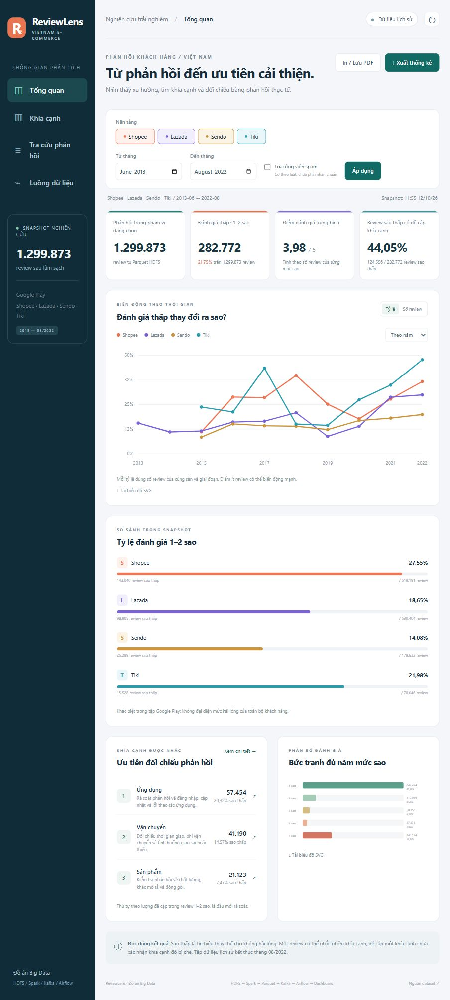

# Phát hiện khía cạnh không hài lòng từ đánh giá ứng dụng TMĐT Việt Nam

Repository nộp môn Bigdata: https://github.com/sangpm2005/DA_BIGDATA

Nhóm: **2001230757 - Huỳnh Quang Sang - 14DHTH13**, **2001230915 - Phan Đức Thể - 14DHTH13**, **2001231033 - Đỗ Trọng Vĩ - 14DHTH06**. Giảng viên: **TS. Huỳnh Thái Học**.

Hai báo cáo PDF và mô tả nộp bài nằm trong [`docs/submission/`](docs/submission/). Minh chứng chọn lọc cùng manifest SHA-256 ở [`evidence/verified_20261028/`](evidence/verified_20261028/). Xem [nhật ký và phân công năm tuần](docs/WORK_LOG.md) để phân biệt kế hoạch nhóm với các mốc có log thực tế.

## Cài đặt từ repository

```powershell
git clone https://github.com/sangpm2005/DA_BIGDATA.git
cd DA_BIGDATA
.\scripts\Init-LocalConfig.ps1
```

Script tạo `.env` cục bộ với giá trị ngẫu nhiên, giữ nguyên nếu file đã tồn tại. Mật khẩu đăng nhập Airflow của bản cài mới nằm trong `AIRFLOW_ADMIN_PASSWORD`, tài khoản `airflow`. Không commit hoặc chia sẻ `.env`. Nếu dùng volume database cũ, giữ thông tin đăng nhập đang dùng cho volume đó; không tạo lại mật khẩu tùy ý.

Tải CSV từ [Kaggle](https://www.kaggle.com/datasets/hienbm/vietnamese-ecommerce-review), đặt tên `vietnamese_ecommerce_review.csv` ở thư mục gốc rồi làm tuần tự theo [RUNBOOK](docs/RUNBOOK.md): audit nguồn, build runtime, khởi động HDFS/Spark, upload, chạy batch, Kafka, Airflow và tạo snapshot sản phẩm. Không tải file raw 613 MiB hoặc chỉ mục 400 MB từ Git.

Kết quả tham chiếu: nguồn 1.300.086 record; processed 1.299.873 dòng/khóa; quarantine 74; loại 139 bản sao ID. Minh chứng cơ bản ngày 12/10/2026 có hai lượt replay, tổng end offsets 2.000 và sáu microbatch. Đối soát bổ sung ngày 15/10 có 12 microbatch, chín batch không thêm ID mới; streaming vẫn giữ 1.000 dòng/khóa. Cube có 1.910 nhóm với chín số đếm khớp toàn index. Ngày 28/10 là ngày đóng gói hồ sơ và khởi tạo Git, không phải ngày chạy lại toàn pipeline.

Đồ án Big Data: HDFS → PySpark/Spark SQL → Parquet → khám phá khía cạnh/K-Means → Kafka/Structured Streaming → Airflow. Chạy tại máy bằng Docker Compose. Ưu tiên chứng minh luồng dữ liệu, xử lý phân tán và khả năng chạy lại.

Sản phẩm **ReviewLens** chạy tại **http://localhost:8090**: biểu đồ xu hướng, so sánh bốn sàn, ma trận khía cạnh, tra cứu toàn bộ phản hồi và bằng chứng pipeline. Phục vụ việc tìm chủ đề cần rà soát và đối chiếu với phản hồi gốc. Có xuất SVG/CSV, in trang hiện tại, cùng bộ hình PNG/SVG cho báo cáo.

```powershell
# Nếu snapshot đã được tạo (máy hiện tại đã có):
docker compose --profile dashboard up -d dashboard
```

Pipeline kỹ thuật đã chạy kiểm chứng: Airflow 9/9 task success, 13 tests đạt, Parquet HDFS có 1.299.873 review; hai lượt Kafka replay tạo 2.000 offsets nhưng chỉ giữ 1.000 review duy nhất. Dashboard lấy tổng hợp Spark và chỉ mục tra cứu xuất từ HDFS, không đọc CSV gốc trong mỗi lần bấm. Xem trạng thái và bằng chứng trong `docs/STATUS.md`.

<details>
<summary>Xem ảnh sản phẩm từ snapshot đã kiểm chứng</summary>



</details>

**Phạm vi dữ liệu:** đánh giá ứng dụng Google Play của Shopee, Lazada, Sendo, Tiki; không có giao dịch, giá trị đơn hàng hoặc nhãn khía cạnh chuẩn. Không thể dùng RFM thật, không suy luận quan hệ nhân quả, không coi số sao là cảm xúc đúng tuyệt đối.

- [Lộ trình và tiêu chí nghiệm thu](docs/ROADMAP.md)
- [Kết quả kiểm tra dữ liệu](docs/DATA_AUDIT.md)
- [Thiết kế và kiến thức Big Data cần nắm](docs/ARCHITECTURE.md)
- [Hướng dẫn chạy](docs/RUNBOOK.md)
- [Sử dụng sản phẩm và kịch bản demo](docs/PRODUCT_GUIDE.md)
- [Quy tắc đọc và gán nhãn phản hồi](docs/ANNOTATION_GUIDE.md)
- [Giải thích Big Data khi bảo vệ](docs/DEFENSE_GUIDE.md)
- [Kết quả và giới hạn baseline](docs/RESULTS_BASELINE.md)
- [Nhật ký trạng thái thực tế](docs/STATUS.md)
- [Báo cáo tiến độ dạng PDF](docs/submission/01_Bao_cao_tien_do_Bigdata.pdf)
- [Báo cáo cuối kỳ dạng PDF](docs/submission/02_Bao_cao_cuoi_ky_Bigdata.pdf)

Nguồn: https://www.kaggle.com/datasets/hienbm/vietnamese-ecommerce-review

CSV gốc, kết quả chứa văn bản phản hồi, chỉ mục, volume, cache và `.env` không đưa vào Git. Báo cáo cuối kỳ kế thừa bản theo mẫu khoa và bổ sung ma trận yêu cầu, nguồn bằng chứng, nhật ký và kế hoạch; các trường mục lục, chú thích và số trang được cập nhật trước khi xuất PDF. Git ghi nhận từ lúc khởi tạo repository, không có commit lùi ngày hoặc commit gán thay thành viên.

