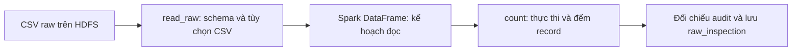

# Bước 3: Đọc dữ liệu từ HDFS bằng Spark

Mục tiêu: đọc CSV raw trên HDFS thành Spark DataFrame với cấu trúc đã xác định, đếm record và đối chiếu với audit độc lập. Bước này kiểm tra đầu vào trước khi làm sạch; chưa loại bản sao, ép kiểu sao/ngày hay nhận diện khía cạnh.

## 1. Đầu vào, quá trình và đầu ra



- Input: `hdfs://namenode:9000/ecommerce/raw/reviews.csv`.
- API: PySpark, Spark 3.5.7, chạy trên Spark standalone của đồ án.
- Kết quả: 1.300.086 record, reader có 1 partition, schema rõ ràng, số record khớp audit.
- Metadata trên HDFS: `/ecommerce/output/raw_inspection/`, là thư mục JSON Spark tạo.
- Bản metadata để xem trên máy: `outputs/raw_inspection.json`.

DataFrame là dữ liệu dạng bảng có tên cột và kiểu dữ liệu, được Spark xử lý theo partition. Tạo DataFrame không có nghĩa đưa toàn bộ 1,3 triệu review vào bộ nhớ Python của driver.

## 2. Spark chạy chương trình ở đâu?

| Thành phần | Vai trò trong lần chạy bằng spark-submit |
|---|---|
| Driver | Chạy chương trình Python, tạo SparkSession, lập kế hoạch và điều phối task; trong lệnh demo nằm tại container spark-client |
| Spark master | Quản lý cấp tài nguyên của cụm standalone tại spark://spark-master:7077 |
| Hai worker | Cung cấp tài nguyên để chạy executor, mỗi worker khai báo 2 core |
| Executor | Thực thi task, đọc dữ liệu từ HDFS và xử lý partition |

HDFS NameNode/DataNode thuộc phần lưu trữ, còn các thành phần Spark thuộc phần xử lý. Việc có hai worker hoặc hai executor không chứng minh mỗi giai đoạn sử dụng đồng thời cả hai.

`jobs/batch_pipeline.py`, dòng 203 tạo SparkSession; cấu hình giới hạn 4 core cho ứng dụng và 2 core/executor. Địa chỉ master được truyền bởi `spark-submit --master`, không viết trực tiếp trong SparkSession builder. SparkSession là điểm truy cập API đọc và xử lý, không phải một bảng dữ liệu hay một worker.

## 3. Schema đã khai báo như thế nào?

Mở `src/review_analytics/spark_ops.py`, dòng 14:

```python
RAW_COLUMNS = ["csv_index", "reviewid", "username", "userimage", "content", "score",
    "thumbsupcount", "reviewcreatedversion", "at", "replycontent", "repliedat", "appid"]
RAW_SCHEMA = T.StructType([T.StructField(c, T.StringType(), True)
    for c in RAW_COLUMNS + ["_corrupt_record"]])
```

CSV nguồn có 12 cột. Cột đầu không có tên trong header được nhóm đặt tên `csv_index`. Nhóm bổ sung `_corrupt_record` để giữ thông tin record có lỗi parse mà chế độ PERMISSIVE phát hiện; DataFrame vì vậy có 13 trường.

`StructType` mô tả cấu trúc bảng; mỗi `StructField` mô tả một cột. Tất cả được đọc dưới dạng string và cho phép null ở bước raw. `score` vẫn là chuỗi, `at` vẫn là chuỗi; việc chuyển sang số/ngày và kiểm tra hợp lệ nằm ở bước làm sạch. Giữ chuỗi giúp kiểm tra dữ liệu đầu vào trước khi ép kiểu; không dùng inferSchema để tự đoán kiểu.

Schema cố định của reader áp dụng theo thứ tự cột vì `enforceSchema=True`. Audit đã ghi lại thứ tự header nguồn, bao gồm cột đầu trống. Nếu nguồn mới thay đổi thứ tự, phải kiểm tra lại trước khi sử dụng reader này; chỉ thấy tên cột DataFrame đẹp hoặc count khớp không đủ bảo đảm ánh xạ đúng từng trường. Apache khuyến nghị cân nhắc tắt enforceSchema để kiểm tra header; cấu hình hiện tại phù hợp cách đặt lại tên cột trống của dataset đã audit, chưa phải reader tổng quát cho mọi CSV.

## 4. Source đọc CSV và các tùy chọn

Mở `src/review_analytics/spark_ops.py`, dòng 21:

```python
def read_raw(spark, path: str) -> DataFrame:
    return (spark.read.schema(RAW_SCHEMA).option("header", True)
        .option("multiLine", True).option("quote", '"').option("escape", '"')
        .option("mode", "PERMISSIVE").option("enforceSchema", True)
        .option("columnNameOfCorruptRecord", "_corrupt_record").csv(path))
```

| Tùy chọn | Ý nghĩa trong dataset hiện tại |
|---|---|
| schema(RAW_SCHEMA) | Chủ động xác định tên, thứ tự và kiểu cột |
| header=True | Xử lý dòng đầu là header, không đếm thành review |
| multiLine=True | Cho phép một record có trường được đặt trong nháy chứa xuống dòng |
| quote='"' | Nhận diện trường được bao bằng dấu nháy, giữ dấu phẩy trong nội dung |
| escape='"' | Xử lý dấu nháy được biểu diễn bằng hai dấu nháy bên trong trường CSV |
| mode=PERMISSIVE | Giữ thông tin các lỗi parse được phát hiện để kiểm tra ở bước sau |
| columnNameOfCorruptRecord | Chỉ định cột chứa record lỗi parse |
| enforceSchema=True | Áp dụng schema theo vị trí cột của nguồn đã xác định |

Encoding mặc định của CSV reader Spark là UTF-8; code hiện dùng mặc định đó.

Ví dụ minh họa với ba cột, không phải CSV nguồn 12 cột:

```csv
reviewid,content,score
r1,"Hàng ""tốt"",
nhưng giao lâu",2
```

Nội dung có dấu nháy, dấu phẩy và xuống dòng, nhưng đây vẫn là một record review. Đếm dòng văn bản hoặc tách bằng dấu phẩy đơn thuần có thể làm sai cấu trúc. Test `test_csv_quoted_newline_quotes_and_comma` trong `tests/test_spark_logic.py`, dòng 26 dùng fixture đủ 12 cột và xác nhận reader trả một record, giữ đúng content.

PERMISSIVE không phải kiểm tra nghiệp vụ. Sao 0, ngày không hợp lệ và nội dung rỗng chưa được kết luận qua tùy chọn này. Spark còn không coi mọi trường hợp thừa/thiếu token là corrupt record; phải có kiểm tra cột và dữ liệu ở những bước phù hợp.

## 5. Khi nào Spark thực sự đọc và xử lý?

Mở `jobs/batch_pipeline.py`, dòng 29:

```python
raw = read_raw(spark, args.input)
n = raw.count()
```

Tạo DataFrame xác định kế hoạch đọc và metadata cần thiết; action `count()` yêu cầu Spark thực thi để trả số record. Đây là điểm cần hiểu của đánh giá lười: định nghĩa select/filter không đồng nghĩa đã hoàn tất tính toán toàn dữ liệu.

Trong stage inspect, driver nhận số đếm, schema và metadata; không dùng `raw.collect()` lấy toàn bộ 1,3 triệu review về Python. `printSchema()` có thể xem cấu trúc mà không chứng minh đã quét toàn bộ dữ liệu; `show(5)` xem một số record, còn `count()` và audit cung cấp kiểm tra số lượng.

Hàm inspect so count Spark với `artifacts/audit/dataset_profile.json`, được tạo bởi Python csv.DictReader độc lập. Nếu audit có sẵn và số record không khớp, job báo lỗi. Nếu file audit không có, code vẫn đếm nhưng bỏ qua phép đối chiếu; kết quả đã lưu của đồ án có `audit_rows_match=true`.

`source_sha256` trong raw_inspection được lấy từ hồ sơ audit của nguồn. Nó không phải SHA-256 mới được Spark tính từ HDFS; không dùng trường này để nói bước 3 tự đối soát hash file đích.

## 6. Vì sao năm block HDFS nhưng reader có một partition?

`outputs/raw_inspection.json` ghi `reader_partitions=1`. Với một file CSV có multiLine=true, Spark 3.5.7 dùng reader không chia nhỏ file thành các input split độc lập. Ranh giới block không nhất thiết trùng ranh giới record CSV chứa xuống dòng trong nháy.

Block là đơn vị lưu trữ HDFS; partition là phần dữ liệu để Spark tổ chức task. Vì reader có một partition, phần quét/parse CSV này không được chia thành hai tác vụ song song chỉ bởi có hai worker. Các stage khác của count hoặc ghi metadata vẫn có task riêng, nên không nói toàn ứng dụng chỉ có một task.

Ở bước clean tiếp theo, source có `raw.repartition(args.partitions)`, mặc định 8, để phân phối xử lý sau đọc. Repartition không làm phần parse ban đầu tự có tám partition. `spark.sql.shuffle.partitions=8` cũng không quyết định số partition đọc CSV này.

Đọc đúng record trước, sau đó tạo dạng dữ liệu phù hợp xử lý tiếp. Một partition đọc là giới hạn hiệu năng đã nhận biết, không được trình bày là đã chứng minh tốc độ đọc tăng nhờ hai worker. Những tối ưu như nguồn nhiều file có ranh giới record đúng hoặc dữ liệu Parquet cần đánh giá riêng; không cắt CSV tùy ý theo dòng.

## 7. Demo đúng stage của pipeline

Cần HDFS đã có file raw và Spark standalone hoạt động. Mở PowerShell tại D:\Bigdata. Lệnh hướng dẫn dưới đây chưa được chạy lại trong buổi giải thích này:

```powershell
docker compose exec -T spark-client spark-submit --master spark://spark-master:7077 --driver-memory 2g --executor-memory 1g jobs/batch_pipeline.py --stage inspect
```

`spark-submit` gửi chương trình tới môi trường Spark; `--master` chọn cụm standalone; driver/executor memory là cấu hình bộ nhớ; `--stage inspect` chọn riêng bước đọc và kiểm tra. Mặc định --stage all còn chạy các bước sau, nên cần chỉ định inspect khi demo bước 3.

Job in metadata ra terminal và lưu ra HDFS cùng outputs/raw_inspection.json. Kiểm tra:

```powershell
Get-Content -LiteralPath .\outputs\raw_inspection.json -Encoding UTF8
docker compose exec -T spark-client hdfs dfs -ls /ecommerce/output/raw_inspection
```

Metadata trọng tâm đã lưu:

```json
{
  "raw_rows": 1300086,
  "input": "hdfs://namenode:9000/ecommerce/raw/reviews.csv",
  "reader_partitions": 1,
  "multiline": true,
  "spark_version": "3.5.7",
  "audit_rows_match": true
}
```

Không đọc cả thư mục `/ecommerce/raw` bằng csv reader vì nó còn có `source_sha256.txt`; source chỉ chính xác đường dẫn reviews.csv.

## 8. Xem schema và vài review trực tiếp khi thầy yêu cầu

Stage inspect hiện in metadata, không có lệnh show review trong production code. Có thể dùng PySpark tương tác để gọi cùng reader mà không sửa job:

```powershell
docker compose exec spark-client pyspark --master spark://spark-master:7077 --driver-memory 2g --executor-memory 1g --conf spark.cores.max=4 --conf spark.executor.cores=2
```

Tại dấu nhắc Python, nhập:

```python
from review_analytics.spark_ops import read_raw
raw = read_raw(spark, "hdfs://namenode:9000/ecommerce/raw/reviews.csv")
raw.printSchema()
raw.select("reviewid", "appid", "score", "at", "content").show(5, truncate=60)
raw.rdd.getNumPartitions()
raw.count()
```

Schema dự kiến có 12 cột raw cộng `_corrupt_record`, tất cả string. Số partition 1, count 1.300.086. Chỉ show các cột cần trình bày và vài record; không collect toàn bộ dữ liệu về driver. Các lệnh này tạo action riêng, có thể quét lại nguồn; không dùng tổng thời gian nhiều lần demo làm benchmark của một lần inspect.

Giao diện cần mở:

- http://localhost:8081: Spark master, thấy hai worker ALIVE và tổng 4 core khai báo.
- http://localhost:4040: UI của application đang chạy tại spark-client, xem Jobs, Stages và Executors. Job inspect kết thúc sẽ spark.stop(), UI không còn hoạt động; phiên PySpark giữ application sống để xem kết quả vừa chạy.
- DAG: task `03_read_with_spark` tại `dags/ecommerce_pipeline.py`, dòng 21 gọi stage inspect.

Chỉ chạy một application ở cổng UI mặc định nếu cần dùng ánh xạ localhost:4040 hiện tại.

## 9. Minh chứng và giới hạn kết luận

| File/source | Chứng minh |
|---|---|
| src/review_analytics/spark_ops.py:14 và :21 | Schema và lựa chọn CSV reader |
| jobs/batch_pipeline.py:29 | count, metadata và đối chiếu audit |
| outputs/raw_inspection.json | Đọc từ HDFS, count 1.300.086, partition 1, Spark 3.5.7, audit khớp |
| artifacts/audit/dataset_profile.json | Count bằng parser CSV độc lập, header nguồn và thông tin nguồn |
| tests/test_spark_logic.py:26 | Kiểm tra dấu nháy, dấu phẩy và xuống dòng trong content |
| outputs/logs/tests_after_io_fix.log | Test đọc CSV đã đạt trong lần kiểm chứng lưu ngày 12/10 |
| outputs/demo_evidence.json | Task 03 success của run validation_20261012 |
| outputs/cluster_evidence.json và outputs/logs/batch_full.log | Tài nguyên và hai executor trong lần application ecommerce-all đã lưu, không suy ra đọc CSV sử dụng đồng thời cả hai |

Count khớp là kiểm tra quan trọng, nhưng không chứng minh mọi nội dung và ánh xạ cột đều đúng, không thay kiểm tra nghiệp vụ, không chứng minh tăng tốc nhiều máy. Test fixture bổ sung kiểm tra cấu trúc CSV khó; bước 4 xử lý các điều kiện chất lượng dữ liệu.

Các minh chứng là của lần chạy đã lưu; phiên giải thích này chưa chạy lại Spark hoặc xác nhận cụm đang online.

## 10. Đoạn trình bày khoảng một phút

“Sau khi đưa CSV vào HDFS, nhóm dùng PySpark để đọc đường dẫn raw thành DataFrame. Nhóm khai báo schema rõ ràng, ban đầu giữ các trường dưới dạng chuỗi để kiểm tra trước khi chuyển kiểu. Reader bật header, multiLine và cấu hình dấu nháy vì nội dung review có thể chứa dấu phẩy, nháy và xuống dòng. Nhóm gọi count để thực thi, đọc được 1.300.086 record và đối chiếu khớp audit bằng parser CSV độc lập. Kết quả schema, số record và partition được lưu trong raw_inspection. Nhóm có test CSV khó và task 03 đã thành công. Với một file multiLine, reader có một partition dù HDFS lưu năm block và Spark có hai worker; nhóm ghi nhận giới hạn này, rồi phân phối xử lý sau đọc ở bước tiếp theo.”

## 11. Câu hỏi tự kiểm tra

1. HDFS và Spark có vai trò khác nhau thế nào ở bước 3?
2. Schema string của score ở bước raw có nghĩa nhóm không biết đó là số sao không?
3. Một review chứa xuống dòng trong nháy là một hay hai record?
4. printSchema và show 5 record có chứng minh đã đọc đủ 1,3 triệu review chưa?
5. Vì sao count khớp audit vẫn chưa chứng minh dữ liệu sạch?
6. Năm block, một reader partition và hai worker có mâu thuẫn không?

Tài liệu: [Spark CSV](https://spark.apache.org/docs/3.5.7/sql-data-sources-csv.html), [Spark cluster overview](https://spark.apache.org/docs/3.5.7/cluster-overview.html), [DataFrame](https://spark.apache.org/docs/3.5.7/api/python/reference/pyspark.sql/api/pyspark.sql.DataFrame.html), [Lazy evaluation](https://spark.apache.org/docs/3.5.7/rdd-programming-guide.html#rdd-operations), [CSV reader của Apache Spark v3.5.7](https://github.com/apache/spark/blob/v3.5.7/sql/core/src/main/scala/org/apache/spark/sql/execution/datasources/csv/CSVDataSource.scala).
