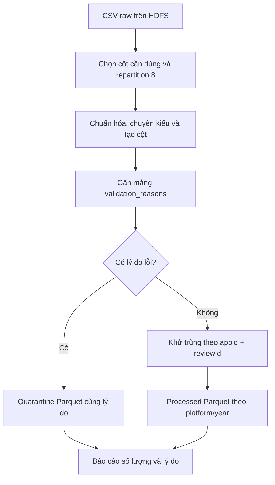

# Bước 4: Làm sạch dữ liệu và ghi Parquet

Mục tiêu: từ CSV raw đã kiểm tra, tạo dữ liệu có kiểu và quy tắc chất lượng rõ ràng; giữ record lỗi để đối chiếu, loại bản sao theo khóa review, rồi lưu Parquet trên HDFS cho Spark SQL.

Lab giao dịch mẫu có thể tính Amount từ giá và số lượng. Dataset review của đồ án không có các trường đó; nhóm điều chỉnh nội dung làm sạch theo text, số sao, thời gian và ứng dụng, giữ phần cốt lõi Spark → kiểm tra → Parquet.

## 1. Luồng thực tế trong source



Source điều phối nằm tại `jobs/batch_pipeline.py`, hàm clean, dòng 45. Hàm này đọc lại CSV bằng reader của bước 3, không lấy dữ liệu review từ raw_inspection.json. raw_inspection.json chỉ là metadata. Khi chạy các stage riêng, mỗi stage là application Spark riêng.

Kết quả đã lưu: 1.300.086 record raw; 74 quarantine; loại 139 bản sao ID trong các record hợp lệ; còn 1.299.873 review processed.

## 2. Chọn cột và phân phối xử lý

```python
raw = read_raw(spark, args.input).select(
    "reviewid", "appid", "content", "score", "at", "_corrupt_record")
prepared = validation_reasons(enrich(raw.repartition(args.partitions))) \
    .persist(StorageLevel.MEMORY_AND_DISK)
```

Chỉ các cột cần xử lý được chọn; username, avatar và phản hồi của nhà phát triển không nằm trong tập phân tích. Nội dung gốc vẫn được giữ trong content.

`args.partitions` mặc định 8. `repartition(8)` phân phối record cho xử lý sau đọc, có shuffle, để các executor thực thi các phần dữ liệu. Nó không làm CSV multiLine của bước đọc ban đầu tự được parse bằng tám task. Hai worker tổng 4 core cũng không đồng nghĩa tám partition chạy đồng thời.

`persist(MEMORY_AND_DISK)` cho phép dùng lại prepared sau khi được tính, vì chương trình cần count, lọc và ghi nhiều lần. Khi không giữ đủ trong memory có thể dùng disk; cuối hàm có unpersist để giải phóng cache. Đây là tái sử dụng dữ liệu tính toán, không phải ghi bền vững lên HDFS. Dữ liệu bền vững được ghi bằng write.parquet.

## 3. Chuẩn hóa văn bản mà vẫn giữ ý nghĩa

Mở `src/review_analytics/text.py`, dòng 6:

```python
def normalize_text(value: str | None) -> str:
    if value is None:
        return ""
    value = unicodedata.normalize("NFKC", value).lower()
    value = re.sub(r"[\u200b-\u200d\ufeff]", "", value)
    return " ".join(value.split())
```

Các thao tác: chuẩn hóa Unicode NFKC, chuyển chữ thường, bỏ một số ký tự vô hình được chỉ định, gom khoảng trắng và xuống dòng. Giữ dấu tiếng Việt và từ phủ định. Ví dụ `  KHÔNG\n hài lòng\t ` trở thành `không hài lòng`; không xóa từ không khiến nghĩa bị đảo.

`content` giữ văn bản nguồn; `normalized_content` là cột riêng để xử lý. Test tại tests/test_text.py kiểm tra dấu/phủ định, ký tự Unicode có dạng khác nhau và ký tự vô hình.

Audit raw có 71 nội dung rỗng. Sau chuẩn hóa có 72, vì thêm một review chỉ chứa ký tự U+200D trở thành rỗng. docs/DATA_AUDIT.md ghi rõ sự khác biệt này; không báo 71 hoặc 72 mà bỏ qua giai đoạn đo.

## 4. Chuyển kiểu và tạo cột

Mở `src/review_analytics/spark_ops.py`, hàm enrich, dòng 28.

| Cột | Cách tạo và mục đích |
|---|---|
| score | Cast chuỗi sang int để kiểm tra số sao và tính thống kê |
| at | Parse chuỗi thành timestamp theo yyyy-MM-dd HH:mm:ss |
| platform | Ánh xạ appid của bốn ứng dụng sang tên sàn |
| review_key | Hash appid:reviewid, lấy 24 ký tự hex, dùng liên kết review trong hệ thống |
| year, month | Tạo từ at, phục vụ phân vùng và thống kê thời gian |
| normalized_content | Nội dung đã chuẩn hóa |
| low_rating_proxy | Cờ score nằm trong 1–2, không phải nhãn cảm xúc người đọc |
| spam_candidate | Cờ ứng viên theo regex, không tự xóa record |
| aspects_mentioned | Các khía cạnh khớp luật từ config/aspects.json |

Trong implementation hiện tại, cột đề cập khía cạnh được gán sớm trong enrich của stage clean; các bước sau tổng hợp và phân cụm. Không nói mọi cột khía cạnh chỉ xuất hiện lần đầu ở task 06. Phần đánh giá luật và phân cụm sẽ học riêng; ở bước 4 cần hiểu đây là các cột bổ sung, không thay điều kiện kiểm tra hợp lệ.

review_key không phải customer ID và hash hữu hạn không có bảo đảm không thể trùng. Với tập đã lưu, kiểm tra thực tế cho thấy số khóa duy nhất bằng số review processed.

## 5. Kiểm tra hợp lệ và ghi quarantine

Hàm validation_reasons tại spark_ops.py, dòng 46 tạo mảng lý do:

| Điều kiện lỗi | Tên lý do |
|---|---|
| CSV parser đã phát hiện record malformed | malformed_csv |
| reviewid null hoặc trống sau trim | missing_reviewid |
| Nội dung chuẩn hóa rỗng hoặc bằng nan/null/none | missing_content |
| score sau chuyển kiểu null hoặc ngoài 1–5 | invalid_score |
| at không chuyển được thành timestamp | invalid_date |
| at trước 01/01/2013 hoặc từ 01/09/2022 trở đi | outside_period |
| appid không ánh xạ được vào bốn ứng dụng | unknown_app |

Không gọi dropna trên mọi cột: các trường không cần phân tích như phản hồi nhà phát triển có thể thiếu mà review vẫn có giá trị.

```python
invalid = prepared.filter(F.size("validation_reasons") > 0)
valid = prepared.filter(F.size("validation_reasons") == 0)
```

Record lỗi được ghi vào `/ecommerce/quarantine/reviews` dạng Parquet, gồm các trường được chọn và mảng lý do. Quarantine không giữ tất cả cột raw nguyên trạng; score/at đã qua chuyển kiểu. CSV raw vẫn là nơi đối chiếu nội dung nguồn ban đầu.

Một record có thể có nhiều lý do. Tổng số lượt lý do không luôn bằng số record lỗi. Với lần chạy đã lưu, 74 quarantine gồm 72 thiếu nội dung và 2 sao bằng 0; hai nhóm không chồng nhau. Test fixture có một record vừa thiếu nội dung vừa sao 0 để kiểm tra trường hợp nhiều lý do.

Spam candidate chỉ được gắn cờ, không nằm trong danh sách lý do loại. Ứng viên theo luật không đồng nghĩa đã xác nhận spam.

## 6. Khử trùng đúng khóa và quy tắc giữ record

Mở hàm deduplicate_valid tại spark_ops.py, dòng 62:

```python
order_hash = F.sha2(F.concat_ws("|", "normalized_content",
    F.col("score").cast("string")), 256)
window = Window.partitionBy("appid", "reviewid") \
    .orderBy(F.col("at").desc(), order_hash.desc())
return frame.withColumn("_rank", F.row_number().over(window)) \
    .filter("_rank = 1").drop("_rank")
```

Nhóm các record hợp lệ theo cặp appid và reviewid, sắp theo at giảm dần, dùng hash nội dung chuẩn hóa/sao làm tiêu chí phụ, giữ rank 1. Nói chính xác là giữ record có at mới nhất trong nhóm hợp lệ theo quy tắc này; at là trường của dataset, không suy ra đã có đầy đủ lịch sử cập nhật review.

| Ví dụ | Xử lý |
|---|---|
| Cùng appid và reviewid, có hai at khác nhau | Giữ bản hợp lệ có at mới hơn |
| Khác reviewid, cùng nội dung ok | Giữ cả hai review |
| Cùng reviewid nhưng khác appid | Hai khóa khác nhau |

Không xóa theo content: nhiều người có thể viết cùng câu ngắn. Các review khác ID cùng nội dung được giữ. Đồ án loại 139 bản sao theo ID, không loại 638.855 lượt lặp văn bản đã thấy trong audit.

Window.partitionBy xác định nhóm cho phép tính cửa sổ, không tạo thư mục Parquet. Các record cùng khóa cần được đưa về nhóm để sắp và chọn, nên bước này có chi phí shuffle/sort. Tiêu chí hash giảm sự tùy ý khi at bằng nhau; các record trùng cả at, hash vẫn hòa tiêu chí, không khẳng định chọn một raw row cụ thể là hoàn toàn xác định trong mọi dữ liệu.

## 7. Ghi Parquet và phân vùng theo sàn/năm

Source tại jobs/batch_pipeline.py, dòng 57:

```python
cleaned.repartition(args.partitions, "platform", "year") \
    .write.mode("overwrite") \
    .partitionBy("platform", "year") \
    .parquet(f"{args.root}/processed/reviews")
```

Parquet lưu theo cột, giữ thông tin schema và hỗ trợ nén. Các bước SQL tiếp theo đọc dữ liệu có kiểu, không phải parse lại CSV nguồn. Khả năng chỉ đọc cột cần dùng và bỏ qua vùng sàn/năm không liên quan sẽ được quan sát trong kế hoạch SQL ở bước 5; không chỉ dựa vào định dạng để khẳng định mọi truy vấn đều nhanh hơn.

Ví dụ cấu trúc thư mục, tên file bên dưới chỉ minh họa:

```text
/ecommerce/processed/reviews/
  platform=Shopee/
    year=2022/
      part-....parquet
  platform=Lazada/
    year=2022/
      part-....parquet
```

Phải phân biệt:

- repartition(8, platform, year) tổ chức các partition thực thi dựa trên khóa.
- writer.partitionBy(platform, year) tổ chức output filesystem theo giá trị cột.
- Window.partitionBy(appid, reviewid) định nghĩa nhóm để khử trùng.
- Block HDFS vẫn là đơn vị lưu trữ byte, không đồng nhất với ba ý nghĩa trên.

Số 8 là tham số partition tính toán yêu cầu, không bảo đảm chỉ có 8 file hoặc 8 thư mục. Số vùng sàn/năm phụ thuộc các giá trị có dữ liệu. Hành vi thực thi thực tế cần xem Spark UI/kế hoạch, không suy từ tham số cấu hình thành benchmark.

mode overwrite tính và ghi lại các output dẫn xuất processed/quarantine khi chạy clean; nguồn raw giữ nguyên. Đây là cách chạy lại batch thực hành, không phải cơ chế versioning hoặc giao dịch nguyên tử bao phủ tất cả output. Parquet hoàn tất và metadata chất lượng không thay thế việc xác thực chất lượng nhận diện khía cạnh.

## 8. Đối chiếu số lượng và bằng chứng độc lập

outputs/data_quality.json ghi:

```text
Raw                     1.300.086
Quarantine                     74
Bản sao ID bị loại             139
Processed               1.299.873

1.300.086 = 74 + 139 + 1.299.873
```

Điểm cần phản biện: code tính duplicates_n bằng raw_n - invalid_n - clean_n. Vì thế row_balance_ok của cùng phép tính không phải một kiểm tra độc lập; nó không tự chứng minh không có lỗi mất/nhân đôi record. Trong dữ liệu đã kiểm chứng, audit raw ghi riêng 139 bản sao ID và lần đọc lại Parquet thật xác nhận 1.299.873 row cùng 1.299.873 review_key duy nhất.

outputs/persisted_validation.json và jobs/validate_persisted.py chứa phép đọc lại HDFS; cùng script còn kiểm tra bảng tổng hợp và streaming, nên không chạy toàn script này để demo riêng bước 4 trên môi trường mới chỉ có clean. Phép kiểm tra processed riêng được hướng dẫn bên dưới.

Đối soát count/unique là kiểm tra cấu trúc và lưu trữ. Chưa có nhãn người đọc thì chưa kết luận 100% nội dung, cờ spam hoặc luật khía cạnh chính xác.

## 9. Demo stage clean và xem output

Điều kiện: raw và cluster đã sẵn sàng. Các lệnh sau là hướng dẫn, chưa được chạy lại trong buổi giải thích này. Chạy stage clean sẽ tính và ghi lại processed/quarantine của nguồn hiện tại.

```powershell
docker compose exec -T spark-client spark-submit --master spark://spark-master:7077 --driver-memory 2g --executor-memory 1g jobs/batch_pipeline.py --stage clean
Get-Content -LiteralPath .\outputs\data_quality.json -Encoding UTF8
docker compose exec -T spark-client hdfs dfs -ls /ecommerce/quarantine/reviews
docker compose exec -T spark-client hdfs dfs -ls /ecommerce/processed/reviews
docker compose exec -T spark-client hdfs dfs -ls /ecommerce/processed/reviews/platform=Shopee
```

Spark application UI http://localhost:4040 khi job còn chạy: xem task sau repartition, shuffle trong xử lý nhóm/sắp xếp, Executors và Storage của các DataFrame persist. Chỉ quan sát task/byte thực tế, không suy rằng có tám partition là có tám task đang chạy đồng thời. NameNode http://localhost:9870 xem thư mục processed/quarantine và file Parquet.

## 10. Đọc lại Parquet để kiểm tra riêng bước 4

Mở PySpark tương tác để SparkSession còn sống trong lúc trình bày UI:

```powershell
docker compose exec spark-client pyspark --master spark://spark-master:7077 --driver-memory 2g --executor-memory 1g --conf spark.cores.max=4 --conf spark.executor.cores=2
```

Tại dấu nhắc Python:

```python
from pyspark.sql import functions as F
root = "hdfs://namenode:9000/ecommerce"
clean = spark.read.parquet(root + "/processed/reviews")
bad = spark.read.parquet(root + "/quarantine/reviews")
clean.printSchema()
clean.agg(F.count("*").alias("rows"),
    F.countDistinct("review_key").alias("unique_keys")).show()
bad.count()
bad.select(F.explode("validation_reasons").alias("reason")) \
    .groupBy("reason").count().show()
clean.select("platform", "content", "normalized_content", "score", "at") \
    .show(5, truncate=60)
```

Kỳ vọng theo lần chạy đã lưu: rows và unique_keys đều 1.299.873; bad.count() là 74; lý do missing_content là 72, invalid_score là 2. Schema có score integer, at timestamp, cờ boolean và mảng khía cạnh. year/platform được Spark nhận từ đường dẫn phân vùng khi đọc gốc processed/reviews.

Không dùng số file Parquet để suy ra số review. Không gọi count trên riêng cột content để thay count(*) khi kiểm tra mọi record, vì count(cột) bỏ qua null.

## 11. Source và minh chứng cần mở

- jobs/batch_pipeline.py:45 — luồng clean, cache, quarantine, dedup, write và thống kê.
- src/review_analytics/text.py:6 — chuẩn hóa Unicode, giữ dấu/phủ định.
- src/review_analytics/spark_ops.py:28 — chuyển kiểu và tạo cột.
- src/review_analytics/spark_ops.py:46 — điều kiện hợp lệ và mảng lý do.
- src/review_analytics/spark_ops.py:62 — khử trùng theo khóa và thứ tự.
- outputs/data_quality.json — các số đếm sau xử lý.
- outputs/persisted_validation.json — đọc lại processed HDFS, count và unique khớp.
- docs/DATA_AUDIT.md — giải thích 71 thành 72 và chính sách giữ nội dung lặp khác ID.
- tests/test_text.py, tests/test_spark_logic.py:39 và outputs/logs/tests_after_io_fix.log — các quy tắc đã có test và kết quả đạt đã lưu.
- dags/ecommerce_pipeline.py:22 và outputs/demo_evidence.json — task 04_clean_to_parquet đã success.

Minh chứng kỹ thuật là của lần kiểm chứng ngày 12/10/2026. Phiên giải thích này đối chiếu source và file đã lưu, không xác nhận job vừa chạy lại hay cluster hiện đang online.

## 12. Đoạn trình bày khoảng một phút

“Ở bước làm sạch, nhóm đọc CSV raw bằng Spark, chọn các cột cần dùng rồi phân phối xử lý sau đọc. Nhóm chuẩn hóa Unicode và khoảng trắng, giữ dấu tiếng Việt và phủ định, chuyển số sao và thời gian sang kiểu phù hợp. Mỗi record được kiểm tra nội dung, ID, sao, ngày, phạm vi thời gian và ứng dụng; record lỗi được đưa vào quarantine cùng lý do. Trong nhóm hợp lệ, nhóm khử trùng theo appid và reviewid, giữ bản theo at mới nhất; các ID khác nhau cùng nội dung vẫn được giữ. Kết quả có 74 quarantine, loại 139 bản sao ID, còn 1.299.873 review. Nhóm ghi Parquet theo sàn và năm trên HDFS, có metadata chất lượng và phép đọc lại xác nhận số row cùng số khóa duy nhất. Phần cốt lõi Big Data thể hiện qua repartition, shuffle, cache và ghi dữ liệu theo phân vùng.”

## 13. Câu hỏi tự kiểm tra

1. Vì sao không xóa mọi review có một cột bị thiếu?
2. Vì sao giữ từ không và dấu tiếng Việt khi chuẩn hóa?
3. Vì sao raw có 71 nội dung rỗng còn sau chuẩn hóa là 72?
4. Khác ID nhưng cùng nội dung có phải bản sao cần loại không?
5. Một record có hai lý do lỗi có được đếm thành hai record quarantine không?
6. repartition, Window.partitionBy và writer.partitionBy khác nhau thế nào?
7. Vì sao row_balance_ok riêng lẻ chưa phải bằng chứng độc lập?
8. Parquet/processed có nghĩa luật khía cạnh đã chính xác 100% không?

Tài liệu đối chiếu: [Spark shuffle](https://spark.apache.org/docs/3.5.7/rdd-programming-guide.html#shuffle-operations), [DataFrame persist](https://spark.apache.org/docs/3.5.7/api/python/reference/pyspark.sql/api/pyspark.sql.DataFrame.persist.html), [Window.partitionBy](https://spark.apache.org/docs/3.5.7/api/python/reference/pyspark.sql/api/pyspark.sql.Window.partitionBy.html), [Parquet](https://spark.apache.org/docs/3.5.7/sql-data-sources-parquet.html), [Writer.partitionBy](https://spark.apache.org/docs/3.5.7/api/python/reference/pyspark.sql/api/pyspark.sql.DataFrameWriter.partitionBy.html).
