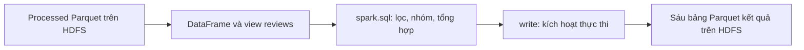

# Bước 5: Phân tích bằng Spark SQL

Mục tiêu: truy vấn toàn bộ review đã làm sạch trên HDFS để tạo các bảng thống kê theo sàn, tháng, số sao và đề cập khía cạnh; hiểu cách Spark thực hiện truy vấn và quan sát kế hoạch đọc dữ liệu/shuffle.

Lab mẫu truy vấn giao dịch. Dataset của đồ án là review Google Play, nên câu hỏi phân tích và mẫu số được điều chỉnh theo review. Không tính doanh thu hoặc số khách hàng từ những trường không có trong nguồn.

## 1. Luồng thực tế và source



Mở `jobs/batch_pipeline.py`, hàm analyze, dòng 72:

```python
reviews = spark.read.parquet(f"{args.root}/processed/reviews")
reviews.createOrReplaceTempView("reviews")
```

DataFrame đọc processed Parquet của bước 4. `createOrReplaceTempView` đăng ký tên reviews để SQL tham chiếu trong SparkSession hiện tại. Nó không sao chép 1,3 triệu review vào một database mới, không tự cache dữ liệu và không tạo bảng bền vững. Khi session kết thúc, view mất; Parquet trên HDFS vẫn còn để session sau tạo lại view.

`spark.sql` tạo DataFrame kết quả. Action như show, count hoặc write kích hoạt tính toán. Trong stage analyze, source ghi từng bảng bằng `table.write.mode("overwrite").parquet(...)`, nên sáu bảng được thực thi và lưu lại. Đây là SQL được engine Spark xử lý trên executor; chương trình không collect toàn bộ processed về driver để tính bằng vòng lặp Python.

## 2. Sáu bảng được tạo và câu hỏi chúng trả lời

| Bảng | Câu hỏi/ý nghĩa | Nơi ghi trên HDFS |
|---|---|---|
| platform_summary | Mỗi sàn có bao nhiêu review, sao trung bình và tỷ lệ sao thấp? | /ecommerce/output/platform_summary |
| monthly_summary | Các chỉ số trên thay đổi theo tháng như thế nào? | /ecommerce/output/monthly_summary |
| rating_distribution | Số review ở từng mức sao của mỗi sàn? | /ecommerce/output/rating_distribution |
| aspect_mentions | Trong review sao thấp, bao nhiêu review đề cập từng khía cạnh? | /ecommerce/output/aspect_mentions |
| unmatched_low_ratings | Bao nhiêu review sao thấp chưa được luật gán khía cạnh? | /ecommerce/output/unmatched_low_ratings |
| spam_sensitivity | Tỷ lệ sao thấp thay đổi thế nào khi bỏ ứng viên spam trong riêng truy vấn này? | /ecommerce/output/spam_sensitivity |

Các CSV cùng tên trong outputs là bản xuất nhỏ của kết quả ở bước 7. Chạy riêng stage analyze ghi lại Parquet HDFS nhưng chưa cập nhật CSV trên máy. Không show CSV cũ rồi nói đó là output mới vừa tạo; có thể đọc trực tiếp bảng Parquet để demo bước 5.

## 3. Giải thích truy vấn nền tảng

Source tại dòng 76:

```sql
SELECT platform,
       COUNT(*) AS reviews,
       AVG(score) AS mean_rating,
       SUM(CASE WHEN low_rating_proxy THEN 1 ELSE 0 END) AS low_rating_reviews,
       AVG(CASE WHEN low_rating_proxy THEN 1.0 ELSE 0.0 END) AS low_rating_rate,
       SUM(CASE WHEN spam_candidate THEN 1 ELSE 0 END) AS spam_candidate_reviews
FROM reviews
GROUP BY platform
ORDER BY platform
```

`FROM` chọn nguồn; `GROUP BY` gom review theo sàn; `COUNT(*)` đếm record của mỗi nhóm; `AVG(score)` tính sao trung bình; CASE tạo giá trị 1 cho review sao thấp, 0 cho các review khác; SUM đếm nhóm sao thấp, AVG của cờ 0/1 tính tỷ lệ. ORDER BY làm thứ tự kết quả rõ khi trình bày.

Sao thấp ở đây là cờ score 1–2 của bước 4. Mẫu số low_rating_rate là tất cả review processed của cùng sàn, không phải chỉ review có khía cạnh hoặc chỉ review 1–2 sao.

AVG bỏ qua null, COUNT(*) đếm record kể cả có giá trị null ở cột khác. Dữ liệu processed đã kiểm tra score hợp lệ nên phép AVG này tính trên số review có sao hợp lệ của nhóm. Nếu sau này thay nguồn, cần giữ cùng quy tắc kiểm tra trước khi so chỉ số.

## 4. Kết quả đã lưu và cách tính đúng toàn tập

| Sàn | Review | Review 1–2 sao | Tỷ lệ sao thấp | Sao trung bình |
|---|---:|---:|---:|---:|
| Lazada | 530.404 | 98.905 | 18,65% | 4,112 |
| Sendo | 179.632 | 25.299 | 14,08% | 4,206 |
| Shopee | 519.191 | 143.040 | 27,55% | 3,772 |
| Tiki | 70.646 | 15.528 | 21,98% | 3,996 |

Toàn tập có 1.299.873 review, 282.772 review sao thấp, tỷ lệ 21,7538% và sao trung bình 3,9830. Các số lấy từ bảng tổng hợp đã lưu, không phải kết quả truy vấn Spark mới trong buổi giải thích.

Tính toàn tập bằng:

```text
Tỷ lệ sao thấp = tổng số review 1–2 sao / tổng review
              = 282.772 / 1.299.873

Sao trung bình = tổng (số sao × số review ở mức sao đó) / tổng review
```

Không lấy trung bình cộng bốn tỷ lệ hoặc bốn mean_rating để thay chỉ số toàn tập: quy mô bốn sàn khác nhau. Tương tự, gộp tháng cần cộng tử số/mẫu số thay vì trung bình tỷ lệ của các tháng có số review khác nhau.

Monthly summary chỉ có những nhóm tháng/sàn xuất hiện trong dữ liệu. Không tự coi tháng không có dòng kết quả là tháng có 0 review mà không xác định nguồn có đầy đủ tháng đó hay không. Tháng có ít review có tỷ lệ biến động mạnh, dữ liệu 2022 chỉ đến tháng 8; đây là các giới hạn khi diễn giải biểu đồ.

## 5. Truy vấn khía cạnh: explode và mẫu số

Source tại dòng 93:

```sql
WITH low AS (
    SELECT * FROM reviews WHERE low_rating_proxy
), denominators AS (
    SELECT platform, COUNT(*) AS low_rating_reviews
    FROM low GROUP BY platform
), mentions AS (
    SELECT platform, explode(aspects_mentioned) AS aspect FROM low
), counts AS (
    SELECT platform, aspect, COUNT(*) AS mention_reviews
    FROM mentions GROUP BY platform, aspect
)
SELECT c.*, d.low_rating_reviews,
       c.mention_reviews * 1.0 / d.low_rating_reviews AS mention_rate_among_low
FROM counts c JOIN denominators d ON c.platform = d.platform
ORDER BY c.platform, c.mention_reviews DESC
```

WITH đặt tên các kết quả trung gian, không mặc định tạo bảng hay cache riêng. `low` chọn review sao thấp; `denominators` đếm tất cả review sao thấp từng sàn; `explode` chuyển mảng khía cạnh thành các dòng; `counts` đếm theo sàn/khía cạnh; JOIN ghép số đếm với đúng mẫu số của sàn.

Ví dụ một review có mảng [product, delivery] sẽ tạo hai dòng khi explode. Mảng rỗng không tạo dòng đề cập, nhưng review vẫn được tính trong denominators vì mẫu số được tính từ low trước explode. Cấu hình tạo mỗi tên khía cạnh tối đa một lần trong mảng của một review, nên count theo từng khía cạnh là số review đề cập khía cạnh đó.

Ví dụ Shopee có 35.467 review sao thấp đề cập ứng dụng. Tỷ lệ đúng cho chỉ số hiện tại là 35.467 / 143.040 = khoảng 24,80%. Mẫu số gồm cả review sao thấp chưa có khía cạnh. Dùng chỉ số khác như tỷ lệ trong tập đã gán cần đặt tên khác và nêu mẫu số riêng.

Một review có thể đề cập nhiều khía cạnh; tổng số đề cập không phải số review duy nhất, không phải số khách hàng. Không cộng các tỷ lệ đề cập thành một cơ cấu bắt buộc bằng 100%.

Các luật đã chạy ở enrich của bước 4; SQL bước 5 tổng hợp mảng đã tạo, không tự phát hiện cảm xúc hoặc huấn luyện mô hình. Ví dụ review sao thấp “hàng tốt nhưng giao chậm” có thể đề cập cả sản phẩm và vận chuyển; đề cập sản phẩm chưa có nghĩa sản phẩm bị chê.

## 6. Vì sao phải đo phần chưa gán và ứng viên spam?

unmatched_low_ratings đếm review sao thấp có size(aspects_mentioned)=0. Toàn tập có 158.216 review chưa gán, còn 124.556 review sao thấp có ít nhất một khía cạnh; độ bao phủ 44,0482%.

Độ bao phủ không phải accuracy, precision hoặc F1. Chưa gán không đồng nghĩa không có vấn đề; review chưa khớp luật vẫn có thể chứa phàn nàn cần đọc kiểm tra.

spam_sensitivity lọc NOT spam_candidate trong riêng câu truy vấn, sau đó tính lại tỷ lệ sao thấp. Processed vẫn giữ các ứng viên vì cờ chưa phải nhãn spam xác thực. Bảng platform_summary có tổng 88 ứng viên; điều này không chứng minh dataset chỉ có 88 spam.

## 7. Kế hoạch SQL đại diện và phần cốt lõi Big Data

Tại dòng 118, source tạo truy vấn:

```sql
SELECT platform, month, COUNT(*)
FROM reviews
WHERE platform = 'Shopee' AND year = 2022
GROUP BY platform, month
```

`outputs/spark_query_plan.txt` chứa Parsed, Analyzed, Optimized Logical Plan và Physical Plan. Parsed thể hiện cú pháp; Analyzed xác định view/cột/kiểu; Optimized tổ chức lại phép đọc/lọc; Physical mô tả các toán tử thực thi.

Các dòng thực tế cần chỉ:

```text
FileScan parquet ... hdfs://namenode:9000/ecommerce/processed/reviews
PartitionFilters: [... (platform = Shopee), (year = 2022)]
ReadSchema: struct<month:string>
HashAggregate ... partial_count(1)
Exchange hashpartitioning(platform, month, 8)
HashAggregate ... count(1)
AdaptiveSparkPlan isFinalPlan=false
```

Giải thích:

1. FileScan cho thấy nguồn đọc là Parquet trên HDFS.
2. PartitionFilters cho thấy lọc theo thư mục platform/year, bỏ qua vùng không liên quan.
3. ReadSchema chỉ có month: platform/year lấy từ đường dẫn phân vùng; không cần đọc content, score và các cột khác từ file cho câu truy vấn này.
4. partial_count là tổng hợp từng phần; Exchange đưa kết quả cùng khóa về nhóm; HashAggregate cuối kết hợp kết quả. Đây là dấu hiệu xử lý tổng hợp và shuffle của Spark SQL.
5. Con số 8 là phân vùng shuffle yêu cầu trong kế hoạch ban đầu; không kết luận có tám máy hoặc tám task chạy đồng thời.

PushedFilters rỗng trong plan này không đồng nghĩa mọi lọc đều không tối ưu; điều kiện đang thể hiện tại PartitionFilters. InMemoryFileIndex là chỉ mục metadata các file/path, không chứng minh 1,3 triệu review đã cache trong RAM. “1 paths” là một đường dẫn gốc, không phải một file hay một partition thực thi.

Giới hạn cần nói rõ: query đại diện được source lấy queryExecution().toString() để lưu plan, không gọi action trên query này. isFinalPlan=false là kế hoạch trước trạng thái AQE cuối. Plan chứng minh lựa chọn thực thi dự kiến và nguồn đọc, chưa là bằng chứng query đại diện vừa chạy, số byte tiết kiệm hoặc tốc độ tăng. Sáu bảng SQL được thực thi bởi write; muốn đo query đại diện cần chạy action và xem metrics SQL/Stages. Adaptive execution có thể thay đổi số partition sau khi có thống kê runtime.

## 8. Tính nhất quán đã đối chiếu từ các bảng nhỏ

Trong buổi giải thích này, đã đọc các CSV tổng hợp có sẵn để kiểm tra:

- Tổng platform_summary bằng 1.299.873 processed review.
- Với từng sàn, tổng review monthly_summary và tổng năm mức sao đều bằng platform_summary.
- Với từng sàn, tổng số review mức 1/2 sao bằng low_rating_reviews.
- Bảng monthly có 377 dòng; rating_distribution có 20 dòng; aspect_mentions có 28 dòng.
- Tổng low_rating_reviews là 282.772; unmatched là 158.216; covered là 124.556.

Đây là kiểm tra nhất quán các bảng đã xuất, không phải một lần chạy lại Spark hoặc đọc lại Parquet hôm nay. outputs/persisted_validation.json của lần kiểm chứng đã lưu còn đối chiếu tổng platform_summary Parquet với processed Parquet thực tế. Các kiểm tra không thay thế nhãn người đọc hoặc kiểm tra nguyên nhân nghiệp vụ.

## 9. Demo đúng stage analyze

Điều kiện: processed Parquet và Spark/HDFS hoạt động. Chạy PowerShell tại thư mục dự án; lệnh hướng dẫn này chưa được chạy trong buổi giải thích:

```powershell
docker compose exec -T spark-client spark-submit --master spark://spark-master:7077 --driver-memory 2g --executor-memory 1g jobs/batch_pipeline.py --stage analyze
docker compose exec -T spark-client hdfs dfs -ls /ecommerce/output/platform_summary
Get-Content -LiteralPath .\outputs\spark_query_plan.txt -Encoding UTF8
```

Stage analyze ghi lại sáu bảng Parquet theo mode overwrite. CSV outputs không được cập nhật bởi riêng stage này. Task 05_spark_sql tại dags/ecommerce_pipeline.py, dòng 23 gọi stage analyze. Không chạy scripts/verify_outputs.py như một validator riêng bước 5 trên môi trường mới vì script đó còn cần các kết quả cluster/export/streaming của những bước sau.

## 10. Mở PySpark để show bảng và query

```powershell
docker compose exec spark-client pyspark --master spark://spark-master:7077 --driver-memory 2g --executor-memory 1g --conf spark.cores.max=4 --conf spark.executor.cores=2 --conf spark.sql.shuffle.partitions=8
```

Tại dấu nhắc Python:

```python
root = "hdfs://namenode:9000/ecommerce"
reviews = spark.read.parquet(root + "/processed/reviews")
reviews.createOrReplaceTempView("reviews")
spark.read.parquet(root + "/output/platform_summary").orderBy("platform").show(truncate=False)
```

Muốn tính trực tiếp, không chỉ đọc bảng kết quả có sẵn:

```python
spark.sql("""
    SELECT platform, COUNT(*) AS reviews,
           SUM(CASE WHEN low_rating_proxy THEN 1 ELSE 0 END) AS low_reviews,
           AVG(CASE WHEN low_rating_proxy THEN 1.0 ELSE 0.0 END) AS low_rate
    FROM reviews GROUP BY platform ORDER BY platform
""").show()
```

Giữ phiên còn sống để mở UI http://localhost:4040, tab SQL/Jobs/Stages/Executors. Chạy query đại diện để quan sát thực thi:

```python
q = spark.sql("""
    SELECT platform, month, COUNT(*) AS reviews
    FROM reviews
    WHERE platform = 'Shopee' AND year = 2022
    GROUP BY platform, month
""")
q.explain("formatted")
q.show()
q.explain("formatted")
```

Explain in kế hoạch; show là action. UI sau action cung cấp thông tin thực thi của action vừa chạy. Đọc trực tiếp Parquet và orderBy khi show; không coi thứ tự file đọc sau này là thứ tự ORDER BY được bảo đảm cho mọi lần đọc.

## 11. Source và minh chứng cần mở

- jobs/batch_pipeline.py:72 — đọc processed, tạo view và sáu truy vấn.
- jobs/batch_pipeline.py:93 — WITH/explode, count đề cập và join mẫu số.
- jobs/batch_pipeline.py:115 — write kết quả Parquet, lưu plan.
- outputs/spark_query_plan.txt — nguồn HDFS, partition filters, read schema và Exchange.
- outputs/platform_summary.csv, monthly_summary.csv, rating_distribution.csv — thống kê đã xuất của lần chạy lưu.
- outputs/aspect_mentions.csv, unmatched_low_ratings.csv, spam_sensitivity.csv — đề cập, chưa gán và độ nhạy.
- outputs/persisted_validation.json — tổng platform_summary khớp processed HDFS của lần kiểm chứng lưu.
- dags/ecommerce_pipeline.py:23 và outputs/demo_evidence.json — task 05_spark_sql đã success.
- Spark UI trong phiên demo — chứng minh action thực thi và metrics thay vì chỉ kế hoạch in ra.

## 12. Đoạn trình bày khoảng một phút

“Ở bước Spark SQL, nhóm đọc Parquet đã làm sạch từ HDFS và đăng ký view reviews. Nhóm dùng SQL để nhóm theo sàn, tháng và số sao; tính tổng review, sao trung bình và tỷ lệ review 1–2 sao. Nhóm còn explode mảng khía cạnh để đếm đề cập, giữ mẫu số là tất cả review sao thấp, và thống kê phần chưa gán. Sáu bảng kết quả được ghi Parquet về HDFS. Toàn tập có 1.299.873 review, 282.772 review sao thấp, khoảng 21,75%. Các tổng theo sàn/tháng/sao đã đối chiếu khớp. Kế hoạch SQL thể hiện đọc HDFS, lọc partition sàn/năm, chỉ đọc cột cần dùng và shuffle khi tổng hợp. Nhóm phân biệt kế hoạch dự kiến với metrics thực thi, và không coi tỷ lệ đề cập là nguyên nhân bất mãn hay tỷ lệ của mọi khách hàng.”

## 13. Câu hỏi tự kiểm tra

1. Temp view reviews có giữ dữ liệu sau khi SparkSession kết thúc không?
2. spark.sql tạo DataFrame đã có nghĩa truy vấn hoàn tất chưa?
3. Vì sao AVG của cờ 0/1 tính được tỷ lệ?
4. Vì sao không lấy trung bình cộng tỷ lệ của bốn sàn để tính toàn tập?
5. Sau explode, một review có hai khía cạnh tạo mấy dòng? Mẫu số lấy ở đâu?
6. Vì sao chưa gán khía cạnh không đồng nghĩa không có phàn nàn?
7. PartitionFilters, ReadSchema và Exchange thể hiện những gì khác nhau?
8. isFinalPlan=false có đủ để báo tốc độ tăng hoặc byte thực tế đã đọc không?
9. Chạy stage analyze có cập nhật CSV tổng hợp trên máy không?

Tài liệu đối chiếu: [Spark SQL](https://spark.apache.org/docs/3.5.7/sql-getting-started.html#running-sql-queries-programmatically), [SQL NULL semantics](https://spark.apache.org/docs/3.5.7/sql-ref-null-semantics.html), [explode](https://spark.apache.org/docs/3.5.7/api/python/reference/pyspark.sql/api/pyspark.sql.functions.explode.html), [explain](https://spark.apache.org/docs/3.5.7/api/python/reference/pyspark.sql/api/pyspark.sql.DataFrame.explain.html), [SQL performance tuning và AQE](https://spark.apache.org/docs/3.5.7/sql-performance-tuning.html).
