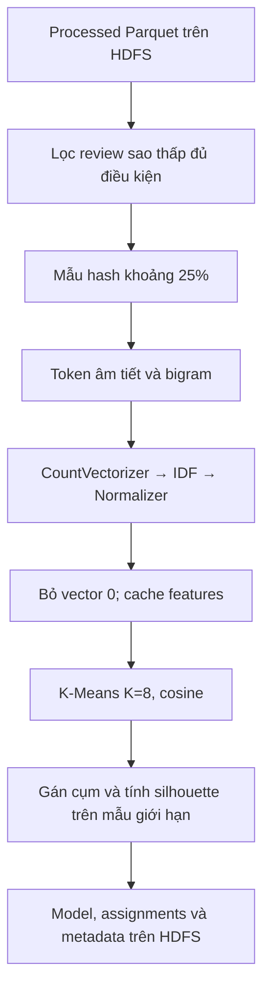

# Bước 6: Khám phá nhóm nội dung bằng TF-IDF và K-Means

Mục tiêu: thực hành biến đổi và phân cụm văn bản bằng Spark ML trên dữ liệu Parquet HDFS; lưu mô hình, kết quả gán cụm, từ khóa và chỉ số để kiểm tra. K-Means là thuật toán machine learning không giám sát; phần Bigdata cần trình bày là tổ chức dữ liệu, xử lý qua Spark, cache, các lần tính toán và lưu artifact có thể chạy lại.

## 1. Vì sao điều chỉnh RFM trong pipeline mẫu?

RFM mô tả khách hàng qua recency (giao dịch gần đây), frequency (tần suất giao dịch), monetary (giá trị chi tiêu). Dataset của đồ án là review Google Play: không có giá trị đơn hàng, lịch sử giao dịch và customer ID ổn định. at là thời gian review, username là tên hiển thị và thumbsupcount là lượt thấy hữu ích; không dùng chúng để giả lập RFM giao dịch.

Nhóm thay phần RFM bằng thống kê review của bước 5, giữ K-Means để khám phá nhóm nội dung ở bước 6. Đối tượng được phân cụm là review, không phải khách hàng. Đây là điều chỉnh theo dữ liệu đã phân tích, không có source tính RFM thật trong bản triển khai hiện tại.

## 2. Luồng code thực tế



Mở jobs/batch_pipeline.py, hàm cluster, dòng 123. Hàm này đọc processed trực tiếp, không lấy bảng tổng hợp SQL làm input phân cụm. Luật khía cạnh và K-Means là hai nhánh khác nhau: luật gán nhiều đề cập có tên từ bước 4; SQL bước 5 tổng hợp đề cập; K-Means bước 6 gán một ID cụm dựa trên vector văn bản của mẫu.

Bảy nhãn khía cạnh không tương ứng một–một với tám cụm. K=8 là cấu hình thực nghiệm ban đầu, chưa được chọn bằng so sánh nhiều K hoặc xác nhận tám loại bất mãn thật.

## 3. Những review nào được đưa vào?

Source tại dòng 124:

```python
candidates = spark.read.parquet(f"{args.root}/processed/reviews").filter(
    "low_rating_proxy AND NOT spam_candidate AND length(normalized_content) >= 10")
training = candidates.filter(
    F.pmod(F.xxhash64("review_key"), F.lit(100)) < args.cluster_percent)
```

Các điều kiện trước lấy mẫu: review 1–2 sao; không có cờ ứng viên spam hiện tại; nội dung chuẩn hóa dài ít nhất 10 ký tự. Cờ spam vẫn là baseline theo regex, chưa phải nhãn người đọc.

xxhash64 tính hash ổn định theo review_key; pmod đưa về bucket 0–99. Mặc định cluster_percent=25 nên chọn bucket 0–24. Đây là mẫu khoảng 25% của tập đủ điều kiện, không phải đúng 25% của 1.299.873 review hay đúng 25% của toàn bộ 282.772 review sao thấp. Sau đó còn lọc ít token và vector 0.

Hash sample cho cùng khóa được chọn nhất quán khi input/quy tắc không đổi. Seed=42 được truyền cho K-Means; code không dùng randomSplit để tạo train/test. Mẫu dùng trong mô hình này khác mẫu annotation 1.000 review đang chờ người đọc gán nhãn.

Số cuối cùng sau xử lý đã lưu là 61.241 vector. Metadata chưa có đầy đủ số record ở mỗi bộ lọc trung gian; không tự điền các số trung gian chưa đo.

## 4. Chuyển văn bản thành token và bigram

Source tại dòng 128 dùng RegexTokenizer theo chữ/số Unicode, minTokenLength=2. StopWordsRemover bỏ danh sách từ phổ biến do nhóm cấu hình, rồi giữ review còn ít nhất hai token.

Ví dụ minh họa:

```text
Văn bản: không đăng nhập được
Token:   [không, đăng, nhập, được]
Sau stopword: [không, đăng, nhập]
Bigram:  [không đăng, đăng nhập]
```

Từ không không nằm trong danh sách stopword hiện tại. NGram(n=2) tạo cặp token liên tiếp; all_terms ghép token đơn và bigram. Vì tạo bigram sau khi bỏ stopword, một số cặp có thể không liền nhau trong văn bản nguồn.

Token ở đây chủ yếu là âm tiết tiếng Việt: đăng và nhập tách riêng, bigram có thể tạo đăng nhập. Không mô tả đây là bộ tách từ tiếng Việt đầy đủ hoặc mô hình hiểu ngữ nghĩa. Regex còn bỏ dấu câu/emoji khỏi biểu diễn token, dù content gốc vẫn giữ để đọc kiểm tra.

## 5. TF-IDF cụ thể là gì?

Mô hình cần vector số để tính khoảng cách. Pipeline tại dòng 135:

```python
feature_model = Pipeline(stages=[
    CountVectorizer(inputCol="all_terms", outputCol="tf",
        vocabSize=10000, minDF=10),
    IDF(inputCol="tf", outputCol="tfidf"),
    Normalizer(inputCol="tfidf", outputCol="features")
]).fit(prepared)
```

| Thành phần | Vai trò |
|---|---|
| CountVectorizer | Học từ điển, biến danh sách term thành vector số lần xuất hiện |
| vocabSize=10000 | Giới hạn tối đa 10.000 term, không phải bảo đảm từ điển đúng 10.000 |
| minDF=10 | Chỉ dùng term xuất hiện trong ít nhất 10 review của tập fit |
| IDF | Giảm trọng số term phổ biến trong nhiều review của tập fit |
| Normalizer | Chuẩn hóa độ dài vector, mặc định chuẩn L2 |

TF-IDF kết hợp tần suất trong review với mức phổ biến của term trong tập review. Ví dụ từ xuất hiện ở hầu hết văn bản thường ít giúp phân biệt nhóm hơn cụm đăng nhập hoặc phí ship trong tập phù hợp. Đây là trọng số văn bản, không phải xác suất không hài lòng.

CV/IDF được fit trên prepared sau lấy mẫu và lọc token, không fit trên toàn bộ processed. Vector thường thưa, chỉ có một số thành phần khác 0. Source bỏ vector không có thành phần khác 0 trước phân cụm vì không có hướng vector hữu ích cho cosine.

Phân biệt fit và transform: fit tạo mô hình từ dữ liệu (ví dụ từ điển và thống kê IDF); transform dùng mô hình/quy tắc để thêm cột. PipelineModel đã lưu tại models/tfidf chỉ chứa CV/IDF/Normalizer; tokenizer, stopword và bigram nằm ngoài Pipeline đó. Muốn áp dụng cho nguồn khác phải tạo all_terms với cùng preprocessing trước, không gọi transform trực tiếp trên raw content rồi cho rằng đầy đủ pipeline.

## 6. K-Means làm gì?

Source tại dòng 144:

```python
model = KMeans(k=args.k, seed=42, maxIter=20,
    distanceMeasure="cosine").fit(features)
predictions = model.transform(features)
```

K-Means chọn tâm cụm, gán vector về tâm gần theo khoảng cách, cập nhật tâm từ dữ liệu trong nhóm và lặp đến điều kiện dừng. Spark hỗ trợ khởi tạo k-means|| cho triển khai phân tán. Trong trường hợp này cosine so sự tương đồng theo hướng vector; đã loại vector 0 và chuẩn hóa vector.

| Tham số | Giá trị và ý nghĩa |
|---|---|
| k | 8, số cụm yêu cầu trong thực nghiệm |
| seed | 42, kiểm soát phần ngẫu nhiên để hỗ trợ tái lập |
| maxIter | 20, số lần lặp tối đa, không khẳng định thực tế chạy đủ 20 |
| distanceMeasure | cosine |
| prediction | ID cụm, trong kết quả hiện tại là 0–7 |

ID cụm không có ý nghĩa thứ hạng, số sao hoặc nhãn app/delivery. Các ID có thể đổi giữa những mô hình khác nhau. Hash và seed giúp giữ điều kiện, không bảo đảm mọi kết quả bit-identical khi thứ tự dữ liệu/tính toán phân tán thay đổi.

Source model.transform chỉ áp dụng cho features của mẫu 61.241 review, không tự gán cụm cho toàn bộ 1,3 triệu review hoặc tất cả review sao thấp.

## 7. Phần Bigdata cần trình bày

1. Đọc/lọc DataFrame từ Parquet HDFS bằng Spark, không đưa toàn bộ dataset về driver.
2. Tạo token và vector qua các stage Spark ML, fit từ điển/IDF cần thống kê trên tập dữ liệu.
3. features và predictions persist MEMORY_AND_DISK để dùng lại khi fit, gán cụm, đánh giá và ghi; unpersist khi xong.
4. K-Means có nhiều lần tính toán theo vòng lặp; quan sát job/stage/task/executor qua Spark UI để thấy cách triển khai trên cụm.
5. Lưu mô hình, kết quả gán cụm và metadata lên HDFS, ghi rõ mẫu và tham số để chạy lại/đối chiếu.

Driver chỉ nhận dữ liệu nhỏ phục vụ giải thích: từ điển tối đa 10.000 term, tám tâm cụm và tối đa ba review mẫu mỗi cụm, hiện có 24 mẫu. Không có collect toàn bộ 61.241 vector hoặc 1,3 triệu review về driver trong đoạn metadata.

Hai worker nằm trên một máy vật lý; source/config cùng UI chứng minh luồng Spark, chưa chứng minh speedup nhiều máy. 25% là lựa chọn thực nghiệm tại máy, không chứng minh mô hình phân cụm toàn dataset. Không dùng thời gian từ một run với silhouette/model của run khác làm một benchmark.

## 8. Silhouette có nghĩa gì và kết quả hiện tại ra sao?

Source tại dòng 146:

```python
evaluator = ClusteringEvaluator(distanceMeasure="cosine")
evaluation_sample = predictions.orderBy(F.xxhash64("review_key")).limit(10000)
silhouette = evaluator.evaluate(evaluation_sample)
```

Evaluator nhận features và prediction, dùng metric silhouette với cosine. Silhouette phản ánh tương quan giữa độ gần trong cụm và với cụm khác, nằm trong khoảng -1 đến 1: gần 1 là phân tách tốt hơn, gần 0 là phân tách yếu, âm có thể thể hiện điểm gần cụm khác hơn.

Đánh giá tối đa 10.000 review chọn theo thứ tự hash từ chính tập đã gán/fit. Đây là đánh giá cấu trúc cụm trên tập con, không phải bộ test nhãn độc lập.

Metadata hiện tại ghi silhouette_cosine=0.019061357094005197, khoảng 0,0191. Cần nói thẳng các cụm còn phân tách yếu. Không đổi thành accuracy 1,91%; không diễn giải thành xác suất nhận diện đúng khía cạnh. docs/RESULTS_BASELINE.md còn ghi lần chạy đầu khoảng 0,0221; hai kết quả thuộc các lần chạy khác nhau.

Task thành công cho thấy luồng kỹ thuật hoàn tất, chưa chứng minh kết quả nội dung tốt. Nhãn annotation còn trống, chưa có precision/recall/F1 khía cạnh đã xác thực.

## 9. Từ khóa và ví dụ trong từng cụm

Source lấy 15 term có trọng số cao nhất ở mỗi tâm cụm để xem chủ đề. Ba ví dụ mỗi cụm được chọn theo hash của review_key; không phải ba review gần tâm nhất hay chắc chắn điển hình nhất.

Một số gợi ý từ metadata hiện tại:

| ID | Term có trong top_terms | Gợi ý đọc, chưa là nhãn xác nhận |
|---|---|---|
| 0 | ứng dụng, lag, chậm, đơ | Trải nghiệm ứng dụng |
| 3 | ship, phí ship, lừa đảo, cao | Có nội dung phí vận chuyển và cáo buộc lẫn nhau |
| 4 | quảng cáo, nhiều, phiền | Quảng cáo gây phiền, cần đọc thêm mẫu |
| 6 | lỗi, đăng nhập, tải, tài khoản | Đăng nhập/thao tác ứng dụng |
| 7 | chất lượng, sản phẩm, kém | Nội dung sản phẩm/chất lượng |

Tất cả human_label hiện vẫn unassigned. Không tự gán nhãn đã xác thực từ vài từ khóa. Một số review trong cùng cụm khác chủ đề; điều này phù hợp cảnh báo silhouette thấp. Cụm quảng cáo có thể gợi ý rà soát phạm vi khía cạnh sau khi người đọc xác nhận; không tự thay taxonomy hoặc chứng minh nguyên nhân từ một cụm.

## 10. Artifact được lưu ở đâu?

| Artifact | Đường dẫn HDFS | Nội dung |
|---|---|---|
| K-MeansModel | /ecommerce/models/kmeans | Tham số và tâm cụm đã fit |
| PipelineModel TF-IDF | /ecommerce/models/tfidf | Từ điển CV, IDF và Normalizer |
| Gán cụm của mẫu | /ecommerce/output/cluster_assignments_sample | review_key, platform, month, prediction |
| Metadata | /ecommerce/output/cluster_metadata | Tham số, silhouette, từ khóa và mẫu review |

outputs/cluster_metadata.json là bản metadata nhỏ trên máy để mở báo cáo. Model và assignments không chỉ nằm trong file JSON này. Tên cluster_assignments_sample ghi rõ kết quả của mẫu. Model dùng overwrite: chạy cluster sẽ ghi lại các artifact này; phải xem model/metadata/assignments của cùng lần chạy khi diễn giải ID cụm.

## 11. Demo đúng stage và kiểm tra artifact

Điều kiện: processed và Spark/HDFS sẵn sàng. Các lệnh sau là hướng dẫn, chưa được chạy lại trong buổi giải thích:

```powershell
docker compose exec -T spark-client spark-submit --master spark://spark-master:7077 --driver-memory 2g --executor-memory 1g jobs/batch_pipeline.py --stage cluster --k 8 --cluster-percent 25
Get-Content -LiteralPath .\outputs\cluster_metadata.json -Encoding UTF8
docker compose exec -T spark-client hdfs dfs -ls /ecommerce/models/kmeans
docker compose exec -T spark-client hdfs dfs -ls /ecommerce/models/tfidf
docker compose exec -T spark-client hdfs dfs -ls /ecommerce/output/cluster_assignments_sample
```

Kỳ vọng của snapshot đã lưu: k=8, seed=42, distance=cosine, training_rows=61.241, sample_percent=25; tám tâm có top_terms và human_label unassigned, 24 review mẫu. Không cam kết silhouette sau chạy lại trùng mọi chữ số.

Spark UI http://localhost:4040 khi application chạy: Jobs/Stages/Executors/Storage cho thấy các action và cache. Spark master http://localhost:8081 cho thấy tài nguyên. Số lần iteration thực tế cần xem summary/metrics của lần chạy, không suy từ maxIter=20.

## 12. Đọc lại gán cụm và mô hình trong PySpark

Mở phiên:

```powershell
docker compose exec spark-client pyspark --master spark://spark-master:7077 --driver-memory 2g --executor-memory 1g --conf spark.cores.max=4 --conf spark.executor.cores=2 --conf spark.sql.shuffle.partitions=8
```

Tại dấu nhắc Python:

```python
from pyspark.sql import functions as F
from pyspark.ml.clustering import KMeansModel
from pyspark.ml import PipelineModel
root = "hdfs://namenode:9000/ecommerce"
assigned = spark.read.parquet(root + "/output/cluster_assignments_sample")
assigned.agg(F.count("*").alias("rows"),
    F.countDistinct("review_key").alias("unique_keys")).show()
assigned.groupBy("prediction").count().orderBy("prediction").show()
km = KMeansModel.load(root + "/models/kmeans")
print(km.getK(), km.getDistanceMeasure())
tfidf = PipelineModel.load(root + "/models/tfidf")
print(len(tfidf.stages[0].vocabulary))
```

Đây là kiểm tra đọc artifact sau khi đã ghi. Số assignments/unique cần khớp training_rows nếu artifact cùng snapshot. Count từng cụm là số review trong mẫu, không báo thành tỷ lệ toàn dataset. len(vocabulary) cho kích thước thực tế, không suy từ giới hạn 10.000.

Muốn đọc content cho một cụm, join assignments với processed theo review_key và chỉ show vài cột/record:

```python
processed = spark.read.parquet(root + "/processed/reviews")
assigned.filter(F.col("prediction") == 4).join(
    processed.select("review_key", "content"), "review_key") \
    .select("prediction", "platform", "content").show(5, truncate=80)
```

Model load thành công chưa chứng minh nội dung cụm đúng; xem review để kiểm tra. Feature Pipeline không nhận raw content trực tiếp vì cần all_terms như đã giải thích.

## 13. Source và minh chứng cần mở

- jobs/batch_pipeline.py:123 — lọc, hash sample, token/vector, fit, transform, evaluate và lưu artifact.
- jobs/batch_pipeline.py:135 — Pipeline TF-IDF.
- jobs/batch_pipeline.py:144 — K-Means, tham số và evaluator.
- jobs/batch_pipeline.py:149 — model và assignments HDFS.
- outputs/cluster_metadata.json — kết quả hiện lưu, không phải một lần chạy mới.
- docs/RESULTS_BASELINE.md — so sánh kết quả của các lần chạy và giới hạn.
- docs/ROADMAP.md — lý do điều chỉnh RFM theo dữ liệu review.
- docs/ANNOTATION_GUIDE.md — mẫu người đọc còn chờ gán nhãn, khác hash sample của K-Means.
- dags/ecommerce_pipeline.py:24 và outputs/demo_evidence.json — task 06_review_aspects_and_kmeans success trong validation_20261012.
- HDFS/UI trong demo — model, assignments và các task thực thi; kiểm tra artifact đọc lại khi cần.

## 14. Đoạn trình bày khoảng một phút

“Bước sáu của nhóm điều chỉnh RFM vì nguồn review không có lịch sử giao dịch, số tiền và định danh khách hàng ổn định. Nhóm giữ K-Means để khám phá nhóm nội dung. Từ processed Parquet HDFS, nhóm lọc review sao thấp đủ điều kiện, lấy mẫu hash khoảng 25%, tạo token âm tiết/bigram rồi TF-IDF và chuẩn hóa vector bằng Spark ML. Sau các bộ lọc có 61.241 vector; nhóm fit K-Means K=8, seed=42, khoảng cách cosine. Mô hình, gán cụm của mẫu và metadata được lưu HDFS. Silhouette trên mẫu đánh giá giới hạn khoảng 0,0191, nên nhóm ghi nhận phân tách còn yếu và nhãn cụm chưa xác nhận. Phần Bigdata thể hiện ở luồng DataFrame trên Spark, cache, tính toán theo các stage và lưu artifact để chạy lại; chưa coi cụm là tám nguyên nhân bất mãn hoặc kết quả phân loại đã chính xác.”

## 15. Câu hỏi tự kiểm tra

1. Vì sao username, at và thumbsupcount chưa đủ làm RFM giao dịch?
2. Tám cụm có phải tám loại khách hàng hoặc tám nhãn khía cạnh chuẩn không?
3. Mẫu 25% có phải 25% của toàn bộ 1,3 triệu review không?
4. Vì sao phải chuyển văn bản thành vector và bỏ vector 0?
5. fit và transform khác nhau thế nào?
6. Silhouette 0,0191 có phải accuracy 1,91% không?
7. Ba review mẫu một cụm có chắc là ba review gần tâm nhất không?
8. Các lệnh collect trong metadata đang lấy toàn bộ dataset hay chỉ phần nhỏ nào?
9. Vì sao cần model, metadata và assignments của cùng lần chạy?

Tài liệu đối chiếu: [RFM trong Microsoft Commerce](https://learn.microsoft.com/en-us/dynamics365/commerce/set-up-rfm-analysis), [Spark features/TF-IDF](https://spark.apache.org/docs/3.5.7/ml-features.html), [CountVectorizer](https://spark.apache.org/docs/3.5.7/api/python/reference/api/pyspark.ml.feature.CountVectorizer.html), [Spark K-Means](https://spark.apache.org/docs/3.5.7/ml-clustering.html), [ML Pipeline](https://spark.apache.org/docs/3.5.7/ml-pipeline.html), [ClusteringEvaluator](https://spark.apache.org/docs/3.5.7/api/python/reference/api/pyspark.ml.evaluation.ClusteringEvaluator.html), [Source ClusteringMetrics v3.5.7](https://github.com/apache/spark/blob/v3.5.7/mllib/src/main/scala/org/apache/spark/ml/evaluation/ClusteringMetrics.scala).
