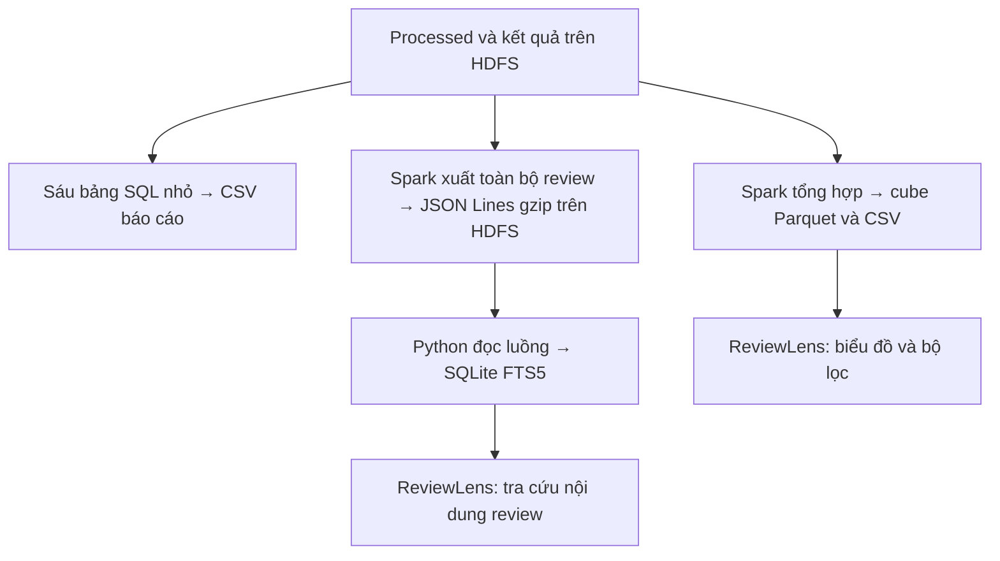

# Bước 7: Lưu kết quả và chuẩn bị dữ liệu phục vụ sản phẩm

Mục tiêu: giữ các kết quả có thể đọc lại trên HDFS, xuất các bảng tổng hợp nhỏ về máy và chuẩn bị snapshot cho ReviewLens. Bước này nối kết quả xử lý Bigdata với báo cáo, biểu đồ và tra cứu review.

## 1. Lưu kết quả diễn ra ở đâu trong pipeline thực tế?

Bước 4 đã ghi processed/quarantine Parquet; bước 5 đã ghi sáu bảng SQL; bước 6 đã ghi model, assignments và metadata. Vì vậy bước 7 không phải thời điểm đầu tiên mọi kết quả được lưu. Trong implementation hiện tại, task 07 hoàn thiện export báo cáo và lớp dữ liệu phục vụ ReviewLens.

Task `07_save_results` tại dags/ecommerce_pipeline.py, dòng 25 gồm ba lệnh nối bằng &&:

1. batch_pipeline.py --stage export: xuất sáu bảng SQL nhỏ thành CSV, ghi batch_success.
2. prepare_dashboard.py: tạo bảng tổng hợp cho bộ lọc và xuất toàn bộ review phục vụ tìm kiếm bằng Spark.
3. build_dashboard_index.py: đọc luồng export HDFS và xây chỉ mục SQLite tại máy.

Nếu một lệnh lỗi, lệnh tiếp theo không chạy. batch_success.json được ghi sau phần export sáu bảng, trước hai công việc phục vụ; riêng marker này chưa chứng minh toàn task 07 hoặc toàn pipeline đã hoàn thành.

## 2. Hai nhánh dữ liệu cần phân biệt



HDFS giữ dữ liệu xử lý và các artifact; SQLite là bản phục vụ tra cứu tại máy, có thể tạo lại từ HDFS. Việc xây chỉ mục là công việc Python/SQLite tuần tự, không phân tán. Sản phẩm đọc snapshot đã chuẩn bị, không chạy lại job Spark trên 1,3 triệu review cho mỗi lần bấm biểu đồ.

## 3. Xuất bảng nhỏ thành CSV

Source tại jobs/batch_pipeline.py, dòng 172:

```python
for name in names:
    frame = spark.read.parquet(f"{args.root}/output/{name}")
    rows = frame.limit(10001).collect()
    if len(rows) > 10000:
        raise ValueError("Only small aggregated tables may be exported to the driver")
    with atomic_text_writer(args.exports / f"{name}.csv",
            encoding="utf-8-sig", newline="") as handle:
        writer = csv.DictWriter(handle, fieldnames=frame.columns)
        writer.writeheader()
        writer.writerows(r.asDict() for r in rows)
```

collect đưa record kết quả về driver. Chúng ta chỉ dùng cho các bảng tổng hợp nhỏ, lấy tối đa 10.001 dòng để phát hiện vượt giới hạn 10.000 rồi báo lỗi; không âm thầm cắt bảng lớn còn 10.000 dòng và xuất như đầy đủ. Giới hạn theo số dòng cũng không phải bảo đảm kích thước byte nhỏ cho mọi loại dữ liệu; sáu bảng của đồ án hiện có cột thống kê ngắn và số dòng thấp.

| CSV | Số dòng dữ liệu hiện lưu |
|---|---:|
| platform_summary.csv | 4 |
| monthly_summary.csv | 377 |
| rating_distribution.csv | 20 |
| aspect_mentions.csv | 28 |
| unmatched_low_ratings.csv | 4 |
| spam_sensitivity.csv | 4 |

UTF-8 BOM thuận tiện mở tiếng Việt trên ứng dụng bảng tính. CSV writer xử lý quoting; đây là bản xuất báo cáo, không thay kho Parquet HDFS. /exports trong container được bind mount tới D:\Bigdata\outputs theo compose.yaml.

## 4. Lưu metadata và ghi file hoàn chỉnh

Hàm save_metadata tại jobs/batch_pipeline.py, dòng 22 ghi metadata ở hai nơi:

- HDFS: thư mục /ecommerce/output/<name>, dạng JSON Spark, thường có part file và _SUCCESS.
- Máy: outputs/<name>.json, dạng dễ xem cho báo cáo.

Metadata gồm raw_inspection, data_quality, cluster_metadata và batch_success do các stage tương ứng tạo. coalesce(1) tại đây áp dụng cho một bản metadata nhỏ; không gom toàn bộ processed về một partition.

Hàm atomic_text_writer tại src/review_analytics/io.py, dòng 9 ghi file tạm trong cùng thư mục, đóng file, đặt quyền 664 rồi os.replace để công bố file đích. Nếu việc ghi lỗi trước replace, file hoàn chỉnh trước đó được giữ; test_io.py đã có test tình huống này. Nó còn xử lý bài toán artifact dùng chung giữa Spark và Airflow khác UID trong container.

Đây là cơ chế công bố từng file cục bộ. Không khẳng định cả sáu CSV, cube, SQLite, model và mọi output HDFS là một giao dịch nguyên tử, cũng không phải bảo đảm chống mọi sự cố mất điện. Ghi Parquet HDFS và marker _SUCCESS chưa thay việc đọc/kiểm tra output.

## 5. Vì sao cần bảng cube cho ReviewLens?

Sáu bảng cố định thuận tiện báo cáo, nhưng sản phẩm còn lọc nhiều sàn, khoảng tháng và ứng viên spam. jobs/prepare_dashboard.py tạo bảng tổng hợp chi tiết hơn từ toàn bộ processed:

```python
cube = reviews.groupBy("platform", "month", "score", "spam_candidate") \
    .agg(*expressions).withColumn("generation", F.lit(generation))
```

Bốn chiều là sàn, tháng, mức sao và cờ ứng viên spam. Mỗi nhóm có chín số đếm: tổng review, số chưa có khía cạnh và bảy số đếm đề cập khía cạnh.

Trong snapshot hiện tại, 1.299.873 review được tổng hợp thành 1.910 nhóm. 1.910 là số ô/nhóm, không phải số review còn lại sau lọc. Tổng cột reviews của cube vẫn là 1.299.873. Tên cube là quy ước bảng tổng hợp của đồ án; code dùng groupBy, không dùng toán tử Spark cube() sinh mọi cấp tổng hợp.

Cube chứa tất cả mức sao. Khi tính đề cập trong review sao thấp, web chọn các nhóm score 1/2 trước khi cộng. Có thể dùng bảng nhỏ này để tính:

```text
Tổng review = sum(reviews của nhóm được chọn)
Review sao thấp = sum(reviews của nhóm được chọn có score 1/2)
Tỷ lệ sao thấp = review sao thấp / tổng review
Sao trung bình = sum(score × reviews) / tổng review
Độ bao phủ sao thấp = 1 - sum(unmatched_reviews ở score 1/2) / review sao thấp
```

Không lấy trung bình cộng các tỷ lệ của các nhóm có số review khác nhau. Loại ứng viên spam bằng cách chọn spam_candidate=false, khi đó cả tử số/mẫu số thay đổi theo cùng phạm vi.

Cube được ghi Parquet tại /ecommerce/output/dashboard_cube và CSV tại outputs/dashboard_cube.csv. Job kiểm tra tổng review trong cube bằng data_quality.clean_rows trước khi công bố các metadata phục vụ.

## 6. Xuất toàn bộ review cho tra cứu mà không collect toàn bộ

Source prepare_dashboard.py, dòng 42:

```python
(reviews.select("review_key", "platform", "month", "score", "content",
    "spam_candidate", "aspects_mentioned",
    F.date_format("at", "yyyy-MM-dd HH:mm:ss").alias("at"))
    .repartition(8).write.mode("overwrite").option("compression", "gzip")
    .json(f"{root}/serving/review_index"))
```

Spark ghi JSON Lines gzip theo các partition lên HDFS. Mỗi dòng là một JSON object; xuống dòng trong content được biểu diễn trong chuỗi JSON, không đọc JSON serving như CSV raw. Chúng ta chọn các trường cần tra cứu, không export username/avatar.

Bản serving này chứa toàn bộ 1.299.873 processed review, khác với mẫu K-Means 61.241 review. Câu write xử lý dữ liệu qua Spark; không dùng collect toàn bộ để tạo một list review trên driver.

## 7. Xây SQLite FTS5 như thế nào?

scripts/build_dashboard_index.py đọc các file gzip trên HDFS qua hdfs dfs -cat, giải nén và yield từng record. Hàm build gom batch 5.000 record để executemany vào SQLite; không tạo list chứa toàn bộ dataset. Chỉ mục tại outputs/review_search.sqlite hiện có kích thước 400.297.984 byte, khoảng 400 MB thập phân.

Chỉ mục có:

- reviews: nội dung và trường để lọc; review_key UNIQUE NOT NULL.
- review_fts: chỉ mục FTS5 cho tìm kiếm toàn văn.
- metadata: số dòng, generation và các thông tin snapshot.

content giữ nguyên tiếng Việt; search_content là cột phụ được chuẩn hóa không dấu để hỗ trợ tìm kiếm. Nó không thay nội dung phân tích có dấu của các bước trước.

Sau khi insert, script kiểm tra count đúng processed_rows, tạo index lọc, rebuild FTS, kiểm tra integrity FTS và PRAGMA quick_check. SQLite được xây trong file tạm, chỉ thay file đích sau thành công. Nếu build lỗi, không công bố index ghi dở; các test dashboard có tình huống giữ index cũ khi rebuild thất bại.

Đây là lớp phục vụ tương tác tại máy. Nó không thay cách Spark/HDFS đã thực hiện xử lý và không chứng minh xây SQLite là một job phân tán.

## 8. Generation và đối soát giúp tránh lệch dữ liệu

Mỗi lần prepare tạo generation mới, đặt vào cube và dashboard_preparation.json; builder lưu cùng generation vào metadata SQLite. Store.snapshot trong dashboard/server.py, dòng 85 kiểm tra:

1. Có metadata, cube và index.
2. Generation của index khớp preparation.
3. Các dòng cube cùng generation.
4. Tổng reviews trong cube bằng indexed_rows.

Nếu đang cập nhật lệch phiên, sản phẩm báo chưa sẵn sàng thay vì hiển thị số liệu trộn. Generation là mã phiên chuẩn bị, khác SHA-256 nội dung nguồn; tag khớp không phải phép kiểm tra từng byte.

scripts/validate_dashboard.py tính lại GROUP BY bốn chiều bằng SQLite trên toàn reviews, so mọi số đếm với cube Spark. Kết quả đã lưu trong outputs/dashboard_validation.json: 1.910 nhóm × 9 số đếm đều khớp, indexed_reviews=1.299.873, cùng generation.

Độc lập ở cách tổng hợp bằng engine khác; không phải nhãn khía cạnh độc lập của người đọc. Đối soát số đếm không xác nhận luật khía cạnh chính xác hoặc mọi nội dung text đúng theo nguồn gốc. Trong DAG, validator lớp phục vụ được gọi ở task 09; có thể xem bằng chứng này để nghiệm thu output bước 7.

## 9. Bằng chứng đã lưu và kiểm tra trong phiên giải thích

- dashboard_preparation.json: processed_rows=1.299.873, cube_rows=1.910, thời điểm chuẩn bị, generation, hash nguồn và cấu hình khía cạnh.
- dashboard_validation.json: 1.910 × 9 số đếm khớp toàn chỉ mục.
- dashboard_airflow_task07.log: bản task 07 mở rộng đã tạo index đủ 1.299.873 review, command exit 0 và task SUCCESS.
- dashboard_index.log: build/index đã passed.
- batch_success.json: sáu bảng export và thời điểm hoàn tất phần export.

demo_evidence.json ghi DAG cơ bản 9/9 success. Hai task 07/09 sau khi mở rộng được kiểm tra riêng và có log; không gộp các lần này thành một benchmark mới của cả DAG.

Trong phiên giải thích đã đọc sáu CSV nhỏ, đọc cube và mở SQLite mode=ro để kiểm tra count/metadata: cube có 1.910 nhóm, sum(reviews)=1.299.873; SELECT COUNT(*) trong SQLite=1.299.873; generation của cube, preparation và index khớp. Đây là kiểm tra file tại máy, không phải một lần chạy lại Spark/HDFS hoặc full cube audit hôm nay.

## 10. Demo ba công việc của task 07

Điều kiện: các bảng SQL, processed và Spark/HDFS sẵn sàng. Các lệnh dưới đây là hướng dẫn; chưa được chạy lại trong phiên giải thích. Chỉ chạy công việc tiếp theo khi công việc trước thành công; chạy lại sẽ ghi các artifact dẫn xuất theo source hiện tại.

```powershell
docker compose exec -T spark-client spark-submit --master spark://spark-master:7077 --driver-memory 2g --executor-memory 1g jobs/batch_pipeline.py --stage export
docker compose exec -T spark-client spark-submit --master spark://spark-master:7077 --driver-memory 2g --executor-memory 1g jobs/prepare_dashboard.py
docker compose exec -T spark-client python scripts/build_dashboard_index.py
```

Kiểm tra output:

```powershell
Get-Content -LiteralPath .\outputs\batch_success.json -Encoding UTF8
Get-Content -LiteralPath .\outputs\dashboard_preparation.json -Encoding UTF8
docker compose exec -T spark-client hdfs dfs -ls /ecommerce/output/dashboard_cube
docker compose exec -T spark-client hdfs dfs -ls /ecommerce/serving/review_index
```

Có thể chạy đối soát lớp phục vụ sau build, công việc này nằm ở task 09 trong DAG:

```powershell
docker compose exec -T spark-client python scripts/validate_dashboard.py --outputs /exports
```

Phép full audit quét toàn chỉ mục, có thể tốn thời gian; đọc log đã lưu nếu chỉ trình bày minh chứng. Không giả vờ đã chạy audit mới khi chỉ mở JSON.

## 11. Show ở đâu khi thầy yêu cầu?

- Source export: jobs/batch_pipeline.py:172, chỉ rõ limit/collect và CSV writer.
- Source cube/JSON serving: jobs/prepare_dashboard.py:23 và :42.
- Source đọc luồng/index: scripts/build_dashboard_index.py:40 và :80.
- Ghi file hoàn chỉnh: src/review_analytics/io.py:9.
- Kiểm tra cùng phiên: dashboard/server.py:85.
- Đối soát đầy đủ: scripts/validate_dashboard.py:20 và dashboard_validation.json.
- NameNode http://localhost:9870: output/models/serving trên HDFS khi dịch vụ hoạt động.
- Thư mục D:\Bigdata\outputs: CSV và JSON nhỏ dễ mở, file SQLite phục vụ.
- ReviewLens http://localhost:8090 khi server đã chạy: đổi bộ lọc, xem biểu đồ và tra cứu review. Kiểm tra API health/overview theo RUNBOOK nếu cần; mở web đọc snapshot không chứng minh HDFS/Spark đang chạy trực tiếp lúc đó.

Để chỉ trình bày, có thể mở file/log đã có mà không tái tạo toàn snapshot. Bản SQLite là artifact tạo lại; số review trong chỉ mục và số ô cube cần được nêu riêng.

## 12. Đoạn trình bày khoảng một phút

“Ở bước lưu kết quả, nhóm hoàn thiện các output đã tạo trên HDFS và chuẩn bị dữ liệu phục vụ sản phẩm. Các bảng SQL nhỏ được xuất CSV có giới hạn số dòng đưa về driver. Spark còn tạo cube theo sàn, tháng, sao và cờ spam, tổng hợp 1.299.873 review thành 1.910 nhóm để bộ lọc và biểu đồ dùng số đếm nhỏ. Toàn bộ review được Spark xuất JSON Lines gzip trên HDFS, rồi Python đọc theo luồng để tạo SQLite FTS5 cho tra cứu tại máy. Các file được công bố qua tệp tạm, cube và index gắn cùng generation. Nhóm có đối soát 1.910 nhóm với chín số đếm, đều khớp toàn chỉ mục. HDFS/Spark giữ vai trò xử lý, còn lớp phục vụ giúp xem và kiểm tra kết quả; nhóm không collect toàn dataset về driver hoặc coi xây SQLite là xử lý phân tán.”

## 13. Câu hỏi tự kiểm tra

1. Nếu bước 5/6 đã ghi HDFS, bước 7 bổ sung những công việc gì?
2. collect bảng 4 dòng khác collect 1,3 triệu review như thế nào?
3. 1.910 dòng cube có nghĩa chỉ còn 1.910 review không?
4. Vì sao biểu đồ và tìm kiếm dùng hai bản dữ liệu khác nhau?
5. CSV/JSON/SQLite local và Parquet HDFS có vai trò khác nhau thế nào?
6. Generation có phải SHA-256 nguồn hoặc giao dịch nguyên tử của mọi file không?
7. batch_success.json có đủ chứng minh toàn task 07 mở rộng hoàn thành không?
8. Đối soát số đếm đúng có nghĩa luật khía cạnh được xác thực không?

Tài liệu đối chiếu: [Spark collect](https://spark.apache.org/docs/3.5.7/api/python/reference/pyspark.sql/api/pyspark.sql.DataFrame.collect.html), [Spark JSON Lines](https://spark.apache.org/docs/3.5.7/sql-data-sources-json.html), [SQLite FTS5](https://www.sqlite.org/fts5.html), [Python os.replace](https://docs.python.org/3.11/library/os.html#os.replace).
