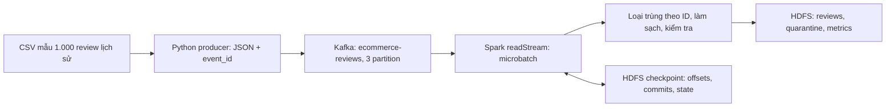

# Bước 8: Kafka ingest và Spark Structured Streaming

Mục tiêu: hiểu cách tiếp nhận từng sự kiện review, xử lý bằng Spark theo các microbatch, lưu kết quả và khôi phục tiến độ từ checkpoint. Đây là nhánh mô phỏng streaming bằng dữ liệu lịch sử của đồ án, bổ sung cho nhánh batch đã xử lý toàn bộ CSV.

## 1. Bước này giải quyết bài toán gì?

Nhánh batch đọc một nguồn CSV đã có trên HDFS. Trong một hệ thống tiếp nhận phản hồi liên tục, mỗi review có thể đến vào một thời điểm khác nhau. Kafka làm lớp tiếp nhận, giữ các lần gửi dưới dạng log; Spark đọc phần dữ liệu chưa xử lý và áp dụng quy tắc làm sạch.

Implementation hiện tại phát lại mẫu 1.000 review lịch sử. Không có crawler thu thập review mới, không có kết nối trực tiếp Shopee/Lazada/Sendo/Tiki. Các review là phản hồi về ứng dụng trong nguồn nghiên cứu, không được đổi cách gọi thành giao dịch hoặc đơn hàng.



Kafka là lớp log sự kiện, Spark là engine xử lý, HDFS là nơi lưu kết quả và checkpoint. Kafka không tự chạy luật khía cạnh của đồ án.

## 2. Source cần mở

| Nội dung | File và dòng |
|---|---|
| Broker Kafka, listener, volume | compose.yaml:92 |
| Tạo topic ba partition, replication factor một | jobs/replay_kafka.py:28 |
| Producer, tạo event và gửi message | jobs/replay_kafka.py:33 và :58 |
| Nguồn CSV mẫu, giới hạn 1.000 | jobs/replay_kafka.py:73 |
| Schema JSON của sự kiện | jobs/stream_reviews.py:12 |
| readStream, offsets, dedup | jobs/stream_reviews.py:31 |
| Làm sạch và ghi từng microbatch | jobs/stream_reviews.py:39 |
| Checkpoint và trigger | jobs/stream_reviews.py:59 |
| Task 08 gọi producer rồi consumer | dags/ecommerce_pipeline.py:29 |
| Đọc lại dữ liệu HDFS để đối soát | jobs/validate_persisted.py:28 |

Các đường dẫn trên tương đối với D:\Bigdata. Trong container, project ở /workspace; /exports ánh xạ tới D:\Bigdata\outputs.

## 3. Producer chuẩn bị và gửi gì?

Mặc định producer đọc /workspace/artifacts/audit/annotation_sample.csv. scripts/audit_dataset.py tạo mẫu phân tầng theo bốn sàn và năm mức sao, 50 dòng mỗi tầng: 4 × 5 × 50 = 1.000. Mẫu này dùng để demo luồng; tên annotation_sample không có nghĩa đã có nhãn khía cạnh do người đọc xác nhận.

Producer kiểm tra appid, nội dung và sao 1–5 trước khi gửi. Nếu chưa có review_key, nó tạo SHA-256 từ appid:reviewid rồi lấy 24 ký tự hex. Nếu mẫu đã có review_key thì giữ nguyên.

Trích source jobs/replay_kafka.py:58:

```python
event = {
    "event_id": review_key,
    "appid": appid,
    "content": content,
    "score": score,
    "event_time": row.get("at"),
    "ingested_at": datetime.now(timezone.utc).isoformat(),
    "source_mode": "historical_replay",
}
producer.send(args.topic, key=review_key, value=event).get(timeout=30)
```

- event_id: danh tính ổn định của review, không tạo ID mới cho mỗi lần replay.
- Kafka key: cũng là review_key, phục vụ phân phối message vào partition.
- value: JSON UTF-8 chứa nội dung và metadata.
- event_time: thời điểm review trong nguồn lịch sử 2013–08/2022.
- ingested_at: thời điểm phát lại hiện tại, UTC.
- source_mode: historical_replay, ghi rõ bản chất demo.

Không đổi event_time thành ngày chạy demo để giả có dữ liệu mới. Producer hiện chờ xác nhận cho từng message; đây không phải benchmark tối ưu throughput.

Producer có acks="all", retries=5. Với topic replication_factor=1 và chỉ một broker, cấu hình này không tạo thêm bản sao trên broker khác. Không suy từ acks="all" thành bảo đảm toàn pipeline không trùng hoặc chịu được mất máy.

## 4. Topic, partition, offset và broker

| Khái niệm | Trong đồ án |
|---|---|
| Producer | jobs/replay_kafka.py, gửi các sự kiện review |
| Topic | ecommerce-reviews, tên luồng review |
| Partition | Ba phần log, đánh số 0, 1, 2 |
| Offset | Vị trí của message trong từng partition |
| Consumer xử lý | Spark Structured Streaming trong jobs/stream_reviews.py |
| Broker | Một dịch vụ Kafka trong Docker, đồng thời làm controller KRaft |

Một message được append vào một partition. Với cấu hình phân vùng không đổi, các lần gửi cùng key đi vào cùng partition; Kafka giữ thứ tự trong partition, không có một thứ tự toàn cục cho cả ba partition. Đọc message không làm Kafka xóa message ngay; retention quyết định thời gian lưu.

Ba partition không phải ba broker, ba bản sao, ba HDFS block hay mặc định ba executor. Có thể đọc song song theo partition nguồn; phép dedup còn tạo công việc shuffle/state với spark.sql.shuffle.partitions=8 trong source.

Kết nối nội bộ container dùng kafka:29092. Client chạy trên Windows dùng localhost:9092. localhost bên trong spark-client là container đó, không phải broker Kafka.

Quan trọng: cùng Kafka key không tự loại message trùng. Gửi lại cùng event_id vẫn tạo message ở offset mới. Bước xử lý bằng Spark mới loại các review đã thấy.

## 5. Spark đọc và giải mã sự kiện

Trích jobs/stream_reviews.py:31:

```python
kafka = (spark.readStream.format("kafka")
    .option("kafka.bootstrap.servers", args.bootstrap)
    .option("subscribe", args.topic)
    .option("startingOffsets", "earliest")
    .option("maxOffsetsPerTrigger", 500)
    .option("failOnDataLoss", "true")
    .load())
```

readStream tạo nguồn streaming. value ban đầu là binary; code cast sang string, from_json bằng EVENT_SCHEMA, rồi giữ topic/partition/offset để biết vị trí message.

startingOffsets="earliest" áp dụng khi tạo query mới chưa có checkpoint. Khi khôi phục query bằng cùng checkpoint, Spark tiếp tục vị trí đã lưu, không tự đọc lại từ đầu mỗi lần chạy.

maxOffsetsPerTrigger=500 là giới hạn tốc độ theo tổng offsets của các partition, không phải 500 mỗi partition hoặc cam kết mọi batch có đúng 500 review hợp lệ. Metrics new_unique_events được tính sau dedup, khác số message đầu vào. Một batch có thể nhỏ hơn giới hạn.

failOnDataLoss=true cho phép query báo lỗi khi phát hiện khả năng mất dữ liệu nguồn, chẳng hạn offset cần đọc đã không còn. Nó không khôi phục được message đã bị retention xóa.

## 6. Microbatch và trigger

Microbatch là một đợt xử lý nhỏ: Spark lấy một khoảng offsets mới, xử lý bằng DataFrame và ghi kết quả. Nhiều microbatch tạo thành một query streaming.

Trích source jobs/stream_reviews.py:59:

```python
writer = events.writeStream.foreachBatch(write_batch).option(
    "checkpointLocation", f"{args.root}/checkpoints/reviews-v1")
writer = (writer.trigger(processingTime="10 seconds")
          if args.continuous else writer.trigger(availableNow=True))
query = writer.start()
query.awaitTermination()
```

Mặc định availableNow=True: xử lý dữ liệu có sẵn khi khởi chạy, có thể qua nhiều microbatch, rồi kết thúc để task Airflow hoàn tất. Muốn xử lý message gửi thêm sau khi query đã kết thúc thì chạy query tiếp.

Nếu thêm --continuous, chương trình duy trì query với processingTime="10 seconds". Tên cờ này có thể gây nhầm: implementation vẫn chạy microbatch theo chu kỳ, không dùng chế độ Continuous Processing của Spark. Khoảng 10 giây cũng không bảo đảm xử lý xong trong 10 giây nếu công việc lâu hơn.

## 7. Loại trùng và checkpoint phối hợp như thế nào?

Source jobs/stream_reviews.py:36:

```python
.withColumn("dedup_key", F.coalesce(
    "event_id", F.concat_ws(":", "topic", "partition", "offset")))
.dropDuplicates(["dedup_key"])
```

Vì đây là streaming DataFrame, Spark duy trì state chứa các khóa đã thấy qua nhiều batch. HDFS checkpoint tại /ecommerce/checkpoints/reviews-v1 lưu tiến độ offsets, commits và state cần khôi phục.

Ví dụ:

1. Lượt đầu producer gửi review A ở partition 0, offset 10; Spark nhận ID A và ghi một review.
2. Query kết thúc; tiến độ và state được giữ trong checkpoint.
3. Lượt hai producer gửi lại review A, lần này tại một offset mới trong partition 0.
4. Query khởi chạy với cùng checkpoint: đọc message mới, nhận ra A đã có trong state, loại khỏi output.

Ví dụ offset 10 chỉ minh họa, không phải vị trí lấy từ log. Checkpoint và dedup có vai trò khác nhau: checkpoint giúp tiếp tục tiến độ; dedup xử lý các message mới mang ID đã có. Spark quản lý tiến độ đọc nguồn trong checkpoint, không lấy Kafka consumer-group committed offsets làm căn cứ chính cho query này.

Nếu event_id thiếu, fallback dùng topic:partition:offset để không gom mọi null ID thành một nhóm; validation sau đó loại record thiếu ID. Fallback này không nhận diện hai message ở offsets khác nhau là cùng một review.

Hiện không có watermark, state tăng theo số ID duy nhất: phù hợp demo hữu hạn, cần thiết kế giới hạn state nếu chạy lâu dài. Không có tổng hợp theo cửa sổ thời gian ở bước này. Watermark của Spark dựa trên tiến triển event time đã quan sát, không đơn giản là ngày hiện tại trừ một khoảng thời gian.

Dedup theo ID cũng không phải cơ chế cập nhật review: nếu cùng ID được sửa nội dung, code hiện loại lần gửi tiếp. Tiếp nhận các phiên bản review cần một thiết kế cập nhật riêng.

## 8. foreachBatch làm gì và output ở đâu?

Hàm write_batch tái sử dụng enrich và validation_reasons đã học ở bước 4: chuẩn hóa nội dung, ánh xạ sàn, xử lý ngày/sao, cờ đánh giá thấp, cờ spam và luật khía cạnh. Nó không huấn luyện lại K-Means cho mỗi batch.

| Đường dẫn HDFS | Vai trò |
|---|---|
| /ecommerce/streaming/reviews/batch_id=N | Review hợp lệ, Parquet |
| /ecommerce/quarantine/streaming/batch_id=N | ID, vị trí Kafka và lý do lỗi, Parquet |
| /ecommerce/streaming/metrics/batch_id=N | Số unique mới, valid, invalid, JSON |
| /ecommerce/checkpoints/reviews-v1 | Tiến độ và state của query |

outputs/stream_batch_N.json là bản metadata nhỏ tại máy; bản lưu chính của dữ liệu review nằm trên HDFS. batch_id là số thứ tự xử lý, khác event_id của review và offset trong Kafka.

Các output của mỗi batch dùng mode("overwrite") tại thư mục gắn batch_id, giúp lần retry cùng batch không append thêm bản kết quả ở thư mục đó. Tuy nhiên foreachBatch mặc định có ngữ nghĩa ghi at-least-once; việc ghi reviews, quarantine, metrics và JSON local không được bao trong một giao dịch nguyên tử chung. Minh chứng replay không đủ chứng minh exactly-once trong mọi tình huống crash.

Giữ checkpoint khi chạy tiếp. Không xóa checkpoint để ép số batch hoặc số offset giống hình minh chứng; reset checkpoint trong khi giữ output cũ còn có thể làm batch_id bắt đầu lại và ghi đè kết quả cũ.

## 9. Kết quả thật đã lưu

Lượt phát đầu có log outputs/logs/kafka_replay.log: published_events=1000. Log outputs/logs/stream_first.log ghi các batch 0, 1, 2.

| batch_id | new_unique_events | valid | invalid |
|---:|---:|---:|---:|
| 0 | 499 | 499 | 0 |
| 1 | 498 | 498 | 0 |
| 2 | 3 | 3 | 0 |
| 3 | 0 | 0 | 0 |
| 4 | 0 | 0 | 0 |
| 5 | 0 | 0 | 0 |

Các file outputs/stream_batch_0.json đến stream_batch_5.json lưu những con số trên. Tổng review hợp lệ mới là 1.000; ba batch sau replay không sinh review unique mới. Không suy từ valid=0 ở batch sau thành producer không gửi message hoặc Kafka không nhận dữ liệu: record trùng đã bị lọc trước hàm write_batch.

outputs/demo_evidence.json lưu end offsets ba partition: 0 → 662, 1 → 698, 2 → 640; tổng là 2.000 sau hai lượt replay. End offset là vị trí kế tiếp sau message cuối, không phải offset của chính message cuối. Script capture_evidence.py chỉ đọc end offsets, không đo beginning offsets; không dùng tổng end offsets làm phép đếm message tổng quát sau retention hoặc khi log có khoảng trống.

jobs/validate_persisted.py đọc lại Parquet HDFS và metric, không chỉ tin số producer đã in. outputs/persisted_validation.json ghi:

```json
{
  "verification": "passed",
  "streaming_rows": 1000,
  "streaming_unique_keys": 1000,
  "streaming_batches": 6,
  "batches_without_new_unique_events": 3,
  "source": "actual HDFS Parquet and streaming metrics"
}
```

Trong phiên giải thích chỉ đối chiếu source, log và JSON đã có; chưa chạy lại Kafka/Spark/HDFS. Số liệu là minh chứng đã lưu, không phải kết quả một lượt benchmark mới.

## 10. Lệnh demo khi runtime sẵn sàng

Thực hiện tại D:\Bigdata khi Docker, Spark/HDFS và mẫu CSV đã có. Dưới đây là hướng dẫn, chưa được chạy lại trong phiên giải thích. Chạy từng lệnh và chỉ tiếp tục khi lệnh trước thành công.

```powershell
docker compose --profile streaming up -d kafka

docker compose exec -T spark-client python jobs/replay_kafka.py

docker compose exec -T spark-client spark-submit --master spark://spark-master:7077 --driver-memory 2g --executor-memory 1g --packages org.apache.spark:spark-sql-kafka-0-10_2.12:3.5.7 jobs/stream_reviews.py
```

Package là connector Kafka cho Spark 3.5.7/Scala 2.12. Lần đầu có thể cần tải dependencies từ mạng.

Lặp lại hai lệnh producer và spark-submit, giữ nguyên checkpoint, để kiểm tra replay. Nếu đã có state cho đủ 1.000 ID của cùng mẫu, lượt chạy tiếp tạo offsets mới nhưng không thêm review unique. Số batch và tổng offsets khi chạy thêm sẽ khác snapshot minh chứng cũ.

Để xem metadata đã lưu trên Windows:

```powershell
Get-ChildItem -LiteralPath .\outputs -Filter stream_batch_*.json
Get-Content -LiteralPath .\outputs\stream_batch_3.json -Encoding UTF8
Get-Content -LiteralPath .\outputs\persisted_validation.json -Encoding UTF8
Get-Content -LiteralPath .\outputs\demo_evidence.json -Encoding UTF8
```

Kiểm tra thư mục HDFS khi dịch vụ đang chạy:

```powershell
docker compose exec -T spark-client hdfs dfs -ls /ecommerce/streaming/reviews
docker compose exec -T spark-client hdfs dfs -ls /ecommerce/streaming/metrics
docker compose exec -T spark-client hdfs dfs -ls /ecommerce/checkpoints/reviews-v1
```

Có thể chạy jobs/validate_persisted.py bằng spark-submit theo RUNBOOK để kiểm tra lại Parquet. Validator còn đọc processed/platform_summary và data_quality của nhánh batch, nên cần cả các output đó, không phải validator cho riêng một topic mới.

## 11. Show ở đâu và tiêu chí nghiệm thu

Mở source producer để chỉ rõ topic/partition và event_id; mở source consumer để chỉ rõ readStream, dedup, foreachBatch và checkpoint. Dùng VS Code hoặc editor để xem các file này.

Mở metadata/log trong D:\Bigdata\outputs để đối chiếu hai lượt replay. Khi hệ thống hoạt động, NameNode http://localhost:9870 có thể browse streaming/checkpoints; Spark UI http://localhost:4040 xem query/job đang chạy, chỉ hiện khi application còn hoạt động. Query availableNow có thể kết thúc nhanh; log đã lưu vẫn dùng được để trình bày.

Đồ án chưa có Kafka UI riêng. Không gọi các file JSON là giao diện Kafka hoặc hình chụp dịch vụ đang hoạt động.

| Tiêu chí | Minh chứng phù hợp |
|---|---|
| Có lớp ingest Kafka | Source producer, cấu hình broker, log published_events |
| Có xử lý streaming bằng Spark | readStream, microbatch, log và metrics |
| Có dữ liệu lưu bền | Thư mục HDFS và phép đọc lại Parquet |
| Có khôi phục tiến độ/state | checkpointLocation, cùng checkpoint qua hai lượt |
| Replay không tăng unique | End offsets tăng; HDFS vẫn 1.000 rows/unique keys |
| Trình bày đúng phạm vi | historical_replay, mẫu 1.000, một broker, không watermark |

Source chứng minh thiết kế; log và phép đọc lại HDFS chứng minh lượt chạy đã có. Chỉ container Up hoặc task xanh chưa đủ chứng minh dữ liệu đầu ra đúng.

## 12. Bước này đã nối với sản phẩm đến đâu?

ReviewLens hiện đọc snapshot/index đã chuẩn bị từ processed ở bước 7. Nhánh Kafka ghi riêng vào streaming/reviews; code hiện chưa tự gộp nó vào processed, chưa refresh cube/index hoặc phát cảnh báo theo thời gian thực. Cả 1.000 review demo đều lấy từ nguồn lịch sử đã nghiên cứu; cộng thẳng vào tổng batch còn gây trùng.

Ứng dụng tiếp theo có thể là nhận phản hồi mới, cập nhật chỉ số khía cạnh và cảnh báo khi phàn nàn tăng. Muốn triển khai phải có nguồn mới hợp lệ, thiết kế gộp/cập nhật theo khóa, chính sách state/retention và refresh dữ liệu phục vụ. Đây là hướng phát triển, không phải chức năng đã hoàn thành.

## 13. Đoạn trình bày khoảng một phút

“Ở bước 8, nhóm bổ sung nhánh tiếp nhận phản hồi theo luồng bằng Kafka và Spark Structured Streaming. Vì dataset là dữ liệu lịch sử, nhóm phát lại mẫu 1.000 review và ghi rõ historical_replay, giữ ngày review gốc. Producer gửi JSON có ID ổn định vào topic ba partition. Spark đọc theo microbatch, giới hạn offsets, loại trùng theo ID và áp dụng lại quy tắc làm sạch rồi ghi Parquet, dữ liệu lỗi và metrics lên HDFS. Checkpoint lưu tiến độ và state để chạy tiếp. Trong demo hai lượt replay, tổng end offsets của Kafka là 2.000, nhưng phép đọc lại HDFS xác nhận chỉ 1.000 review và 1.000 khóa duy nhất; ba batch sau không tạo unique mới. Kết quả minh chứng tiếp nhận, xử lý và chống trùng qua restart. Nhóm chưa tích hợp nguồn review mới hoặc cập nhật dashboard tự động.”

## 14. Câu hỏi tự kiểm tra

1. Kafka, Spark và HDFS đảm nhận những vai trò khác nhau nào ở bước 8?
2. Ba partition có đồng nghĩa ba broker hoặc ba bản sao không?
3. event_id, Kafka key, offset và batch_id khác nhau thế nào?
4. Tại sao cùng key vẫn tạo message mới khi replay?
5. Khi có checkpoint, startingOffsets=earliest có đọc lại từ đầu không?
6. Kafka nhận thêm message nhưng new_unique_events=0 có mâu thuẫn không?
7. availableNow kết thúc có nghĩa không dùng streaming không?
8. Vì sao tên cờ --continuous có thể làm hiểu sai chế độ Spark?
9. Không có watermark ảnh hưởng đến kích thước state lâu dài thế nào?
10. Minh chứng này có đủ chứng minh exactly-once cho mọi sự cố hoặc dashboard đang cập nhật trực tiếp không?

Tài liệu đối chiếu: [Kafka 3.9: topic, partition, producer/consumer](https://kafka.apache.org/39/getting-started/introduction/), [Spark 3.5.7: Kafka source và offsets](https://spark.apache.org/docs/3.5.7/structured-streaming-kafka-integration.html), [Spark 3.5.7: microbatch, checkpoint, dedup và foreachBatch](https://spark.apache.org/docs/3.5.7/structured-streaming-programming-guide.html).
