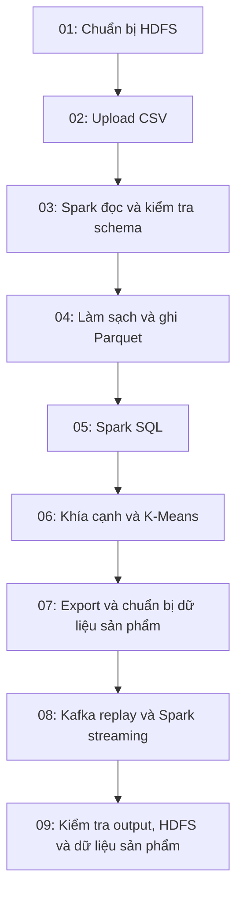

# Bước 9: Airflow DAG điều phối và kiểm tra toàn pipeline

Mục tiêu: hiểu cách ghép các công việc đã học thành một quy trình có thứ tự, trạng thái, log, retry và kiểm tra dữ liệu cuối cùng. Airflow điều phối việc chạy; HDFS lưu dữ liệu, Spark xử lý và Kafka tiếp nhận sự kiện.

## 1. Phân biệt bước 9 trong yêu cầu với task 09 trong source

Trong hình của giảng viên, bước 9 là triển khai Airflow DAG để điều phối toàn pipeline. Airflow không đợi làm xong Kafka rồi mới bắt đầu quản lý: DAG gọi và quản lý các công việc từ bước chuẩn bị HDFS trở đi.

Trong implementation hiện tại, DAG có chín task hiển thị. Task cuối tên 09_verify_completion là công việc kiểm tra kết quả, không phải một lệnh cài Airflow. Bước học này gồm cả DAG điều phối và task kiểm tra cuối đó.

Source chính: D:\Bigdata\dags\ecommerce_pipeline.py. Dag ID: ecommerce_dissatisfaction_pipeline. Runtime Airflow 2.10.5, khai báo tại infra/Dockerfile.airflow:2.

## 2. DAG là gì?

DAG là Directed Acyclic Graph: đồ thị có hướng và không có chu trình. Mỗi nút là task, cạnh là quan hệ phụ thuộc. Đồ án dùng một chuỗi tuyến tính để dễ quan sát và giới hạn tải trên máy.



Dòng dags/ecommerce_pipeline.py:36 khai báo các cạnh:

```python
prepare >> upload >> read >> clean >> sql >> clustering >> export >> kafka >> complete
```

Airflow không suy thứ tự từ tên bắt đầu 01, 02... Các cạnh mới quy định thứ tự. Mặc định trigger rule là all_success: task chỉ được chạy khi các task phụ thuộc trực tiếp đã thành công. Trong chuỗi này, lỗi ở bước trước chặn các bước sau khi không còn retry thành công.

Mũi tên là phụ thuộc điều khiển, không phải truyền toàn bộ review trong RAM giữa các task. Job ghi/đọc qua HDFS và các artifact ở /exports. Không dùng XCom để vận chuyển dataset 1,3 triệu review.

## 3. Phân biệt DAG, task, run và task instance

| Khái niệm | Ví dụ |
|---|---|
| DAG | Định nghĩa quy trình ecommerce_dissatisfaction_pipeline |
| Task | Công việc 04_clean_to_parquet trong định nghĩa DAG |
| DAG Run | Một lần thực thi quy trình, có run_id riêng |
| Task Instance | Công việc 04 trong một DAG Run cụ thể |

Task 04 có thể success ở run trước và failed ở run sau. Khi show giao diện phải chọn đúng run và đúng lần thử của task; một nút màu xanh trong một run không mô tả mọi lần chạy.

run_id không phải SHA-256 dữ liệu hoặc generation của dashboard. Source DAG thay đổi cũng không tự chạy lại toàn bộ lịch sử. Minh chứng của bản DAG trước cần phân biệt với log chạy lại các task đã mở rộng.

## 4. Task gọi source cũ như thế nào?

Code dùng BashOperator để thực hiện lệnh Python hoặc spark-submit. Không chuyển các thuật toán làm sạch, SQL hay K-Means vào scheduler.

Trích dags/ecommerce_pipeline.py:22:

```python
clean = BashOperator(
    task_id="04_clean_to_parquet",
    bash_command=f"{SUBMIT} /workspace/jobs/batch_pipeline.py --stage clean",
)
```

SUBMIT tại dòng 8 là:

```python
SUBMIT = "spark-submit --master spark://spark-master:7077 --driver-memory 2g --executor-memory 1g"
```

Airflow thực thi spark-submit; Spark master nhận application và phân phối công việc cho worker/executor. Chuỗi Airflow tuần tự không làm phép xử lý Spark bên trong mỗi task trở thành tuần tự.

| Task ID | Công việc thực tế |
|---|---|
| 01_prepare_hdfs | bootstrap_hdfs.py --mode prepare |
| 02_upload_csv | bootstrap_hdfs.py --mode upload |
| 03_read_with_spark | batch_pipeline.py --stage inspect |
| 04_clean_to_parquet | batch_pipeline.py --stage clean |
| 05_spark_sql | batch_pipeline.py --stage analyze |
| 06_review_aspects_and_kmeans | batch_pipeline.py --stage cluster |
| 07_save_results | Export bảng, prepare_dashboard.py, build_dashboard_index.py |
| 08_kafka_replay_and_stream | replay_kafka.py rồi stream_reviews.py |
| 09_verify_completion | verify_outputs.py, validate_persisted.py, validate_dashboard.py |

Trong task 07/08/09, các lệnh nối bằng &&: lệnh tiếp theo chỉ chạy nếu lệnh trước thành công. Nếu xây chỉ mục thất bại ở task 07, không lấy marker batch_success được ghi trước đó làm bằng chứng toàn task đã hoàn tất.

BashOperator dựa vào exit code để xác định kết quả lệnh; script cần để lỗi đi ra ngoài thay vì nuốt exception rồi thoát thành công. Với các job ở đây, assert/exception kiểm tra dữ liệu sẽ làm task lỗi. Exit code 99 là trường hợp skipped theo mặc định của BashOperator, không phải success.

## 5. Cấu hình vận hành cần giải thích

Trích dags/ecommerce_pipeline.py:11:

```python
with DAG(
    dag_id="ecommerce_dissatisfaction_pipeline",
    start_date=pendulum.datetime(2026, 10, 12, tz="Asia/Ho_Chi_Minh"),
    schedule=None,
    catchup=False,
    max_active_runs=1,
    default_args={
        "retries": 1,
        "retry_delay": timedelta(seconds=30),
        "execution_timeout": timedelta(minutes=40),
    },
    tags=["bigdata", "vietnamese-reviews"],
) as dag:
    ...
```

| Cấu hình | Ý nghĩa trong đồ án |
|---|---|
| schedule=None | Trigger thủ công; không có lịch chạy định kỳ |
| catchup=False | Không yêu cầu tự chạy bù các khoảng lịch cũ; hiện không có lịch vì schedule=None |
| start_date | Mốc cấu hình cho DAG, không phải thời gian review hoặc lệnh tự chạy đúng ngày đó |
| max_active_runs=1 | Một run của DAG được hoạt động tại một thời điểm |
| retries=1 | Lần chạy đầu và một lần thử lại nếu lỗi thuộc cơ chế retry |
| retry_delay=30 giây | Chờ trước retry; không cam kết chạy lại đúng giây thứ 30 |
| execution_timeout=40 phút | Giới hạn cho mỗi lần thực thi task, không phải toàn DAG |

Không có dữ liệu mới định kỳ nên schedule=None phù hợp. Sau khi Trigger, scheduler tự điều phối chuỗi theo phụ thuộc. Không gọi implementation hiện tại là thu thập và cập nhật review tự động hằng ngày.

## 6. Những thành phần Airflow đã chuẩn bị

Source cấu hình tại compose.yaml:14 và :127:

| Thành phần | Vai trò |
|---|---|
| airflow-init | Migration database và tạo tài khoản demo |
| airflow-scheduler | Đọc DAG, kiểm tra phụ thuộc và lên lịch task |
| LocalExecutor | Thực thi task bằng process tại môi trường scheduler |
| airflow-webserver | Giao diện chọn run, xem graph/grid/log và Trigger |
| PostgreSQL | Metadata về DAG Run, Task Instance, trạng thái và cấu hình liên quan |
| airflow_logs volume | Log thực thi task |

PostgreSQL này không chứa 1,3 triệu review của đề tài. Review chính nằm trên HDFS; SQLite ở lớp phục vụ tìm kiếm có vai trò khác.

Mount ./dags vào /opt/airflow/dags:ro để Airflow đọc DAG. Mount project vào /workspace:ro để task gọi job. Mount ./outputs vào /exports để lưu artifact nhỏ; volume airflow_logs giữ log.

Dockerfile Airflow đưa Java, Hadoop, Spark và thư viện cần thiết vào image để BashOperator có thể chạy hdfs, spark-submit và producer Kafka. Cài Airflow một mình nhưng thiếu runtime Spark/Hadoop thì lệnh task không chạy được.

compose đặt parallelism=2 và max_active_tasks_per_dag=1; DAG còn có max_active_runs=1 và phụ thuộc tuyến tính. Mục đích là tránh nhiều task của quy trình cùng tranh RAM trên máy. Các giới hạn này khác spark.cores.max và số executor/partition.

Docker Compose khởi động hạ tầng. DAG hiện không tự tạo container HDFS/Kafka hoặc tự khởi động web server ReviewLens.

## 7. Khi task lỗi thì xảy ra gì?

Các trạng thái chính: scheduled/queued → running → success; khi lỗi có thể up_for_retry → running lại, hoặc failed khi hết retry. Task sau có thể upstream_failed vì task trước lỗi, chưa chắc source của task sau đã chạy và bị lỗi.

Ví dụ minh họa: task 04 không ghi được HDFS. Nó báo lỗi, chờ retry nếu còn lượt; task 05 chưa được chạy. Nếu task 04 tiếp tục thất bại và hết retry, các task phụ thuộc bị chặn. Đây là giải thích từ cấu hình và cơ chế Airflow, không phải một thí nghiệm lỗi mới đã thực hiện.

Retry không sửa source sai và không rollback dữ liệu tự động. Cần xem log nguyên nhân, khắc phục, rồi chạy lại task cần thiết cùng phần downstream phù hợp. Không bấm Mark success để làm graph xanh khi công việc chưa chạy đúng.

Một task chứa ba lệnh && sẽ chạy lại toàn bộ nhóm lệnh khi task retry, không chỉ lệnh thứ ba. Vì vậy job phải có cách chạy lại phù hợp: raw cùng hash bỏ qua upload; batch tạo lại artifact dẫn xuất; streaming giữ checkpoint và loại ID trùng. Đây không phải giao dịch nguyên tử chung cho cả pipeline.

Không xóa HDFS hoặc checkpoint chỉ để giải quyết một trạng thái failed. Không chạy tay job ghi vào cùng output đồng thời với DAG đang hoạt động.

## 8. Task 09 kiểm tra những gì?

Trích dags/ecommerce_pipeline.py:32:

```python
complete = BashOperator(
    task_id="09_verify_completion",
    bash_command=(
        "python /workspace/scripts/verify_outputs.py --require-stream && "
        f"{SUBMIT} /workspace/jobs/validate_persisted.py && "
        "python /workspace/scripts/validate_dashboard.py --outputs /exports"
    ),
)
```

### 8.1. Kiểm tra artifact và cân bằng số dòng

scripts/verify_outputs.py:8 đọc data_quality, raw_inspection, batch_success, cluster_metadata và stream_batch_*.json. Nó kiểm tra cân bằng dòng, có dữ liệu sạch, các bảng export không rỗng, một số điều kiện metadata K-Means và metrics streaming hợp lệ.

Theo file đã lưu:

```text
raw = clean + quarantined + duplicate_valid_id_rows_removed
1.300.086 = 1.299.873 + 74 + 139
```

Việc kiểm tra silhouette trong khoảng -1..1 không xác nhận cụm có ý nghĩa nghiệp vụ hoặc luật khía cạnh chính xác. Kiểm tra audit_rows_match phụ thuộc trường đã lưu trong raw_inspection; không quét lại CSV ở script này.

### 8.2. Đọc lại Parquet thật trên HDFS

jobs/validate_persisted.py:21 dùng Spark đọc processed/reviews, output/platform_summary, streaming/reviews và streaming/metrics. Các assert kiểm tra:

- Số processed bằng clean_rows trong báo cáo chất lượng.
- Số processed bằng số review_key duy nhất.
- Tổng review theo sàn bằng tổng processed.
- Số streaming bằng số khóa duy nhất, không tăng review do replay.
- Tổng valid từ metrics bằng số review streaming đã lưu.

Validator lưu outputs/persisted_validation.json và /ecommerce/output/persisted_validation trên HDFS. Nó cần nhánh batch và streaming đã hoàn tất; không phải công việc chỉ xem task state.

### 8.3. Đối soát dữ liệu phục vụ sản phẩm

scripts/validate_dashboard.py:20 tính GROUP BY bằng SQLite trên toàn index rồi so bốn chiều platform/month/score/spam_candidate với cube Spark. So chín số đếm mỗi nhóm; sai khác sẽ raise ValueError.

Kết quả outputs/dashboard_validation.json: 1.299.873 review trong index, 1.910 nhóm × 9 số đếm khớp, generation=e590b4d3244f49ac86ff4de3aef266ea.

Đây là đối soát số đếm bằng engine khác trên index đầy đủ, không phải nhãn khía cạnh độc lập của người đọc. Không kiểm tra giao diện đang chạy hoặc tạo review mới qua Kafka.

## 9. Minh chứng đã lưu và giới hạn của minh chứng

| Artifact | Điều đã chứng minh ở lượt chạy đã lưu |
|---|---|
| outputs/demo_evidence.json | DAG cơ bản validation_20261012 state=success, 9/9 task success |
| outputs/logs/dashboard_airflow_task07.log:114 | Task 07 mở rộng exit 0 và SUCCESS, index đủ 1.299.873 review |
| outputs/logs/dashboard_airflow_task09.log:56 | Task 09 mở rộng đọc HDFS, đối soát cube/index, exit 0 và SUCCESS |
| outputs/persisted_validation.json | processed và streaming có số dòng/số khóa khớp |
| outputs/dashboard_validation.json | Toàn bộ 1.910 nhóm × 9 số đếm khớp index |
| outputs/data_quality.json | Phương trình cân bằng 1.300.086 dòng |

demo_evidence được chụp trước khi task 07/09 mở rộng phần sản phẩm được chạy kiểm tra riêng. Dù log dùng cùng run_id, không ghép các thời điểm đó thành một lần chạy liên tục mới của toàn DAG hoặc benchmark thời gian tổng.

Log dashboard_airflow_task09_initial.log có exit -15; log cuối dashboard_airflow_task09.log mới có exit 0 và SUCCESS. Không dùng log ban đầu để kết luận validator đã hoàn thành, cũng không suy từ việc chạy lại thành một thử nghiệm automatic retry đã được chứng minh.

Trong phiên hướng dẫn chỉ đọc source, log và JSON local, kiểm tra các con số lưu có nhất quán. Chưa Trigger DAG, chưa chạy lại Spark/HDFS hoặc fault injection. Một file JSON tự nó không chứng minh mọi service đang hoạt động ngay lúc trình bày.

## 10. Khởi động để demo khi cần

Thực hiện tại D:\Bigdata. Điều kiện: Docker Desktop Linux containers hoạt động, core Spark/HDFS đã dựng và khỏe, CSV/mẫu audit đã có. Các lệnh dưới đây là hướng dẫn, chưa chạy lại trong phiên giải thích. Chỉ tiếp tục sau khi lệnh trước thành công.

Nếu image Airflow chưa build hoặc Dockerfile đã thay đổi:

```powershell
docker compose --profile orchestration build airflow-init
```

Khởi động hạ tầng và dịch vụ Airflow:

```powershell
docker compose --profile orchestration up -d postgres kafka
docker compose --profile orchestration run --rm airflow-init
docker compose --profile orchestration up -d airflow-webserver airflow-scheduler
docker compose exec -T airflow-scheduler airflow dags list-import-errors
docker compose exec -T airflow-scheduler airflow dags list
```

list-import-errors không có lỗi và list có đúng DAG là kiểm tra nạp source. Chưa phải bằng chứng các task đã xử lý dữ liệu.

Mở http://localhost:8080, tài khoản demo airflow; mật khẩu lấy từ AIRFLOW_ADMIN_PASSWORD trong .env. DAG mới được tạo ở trạng thái pause. Bật DAG rồi Trigger một lần; schedule=None nên bật DAG không tự tạo lịch chạy hằng ngày.

Trong UI chọn đúng DAG Run, xem Graph/Grid, chọn task và Logs để đọc command, error hoặc kết quả kiểm tra. Có thể xem source trong Code hoặc editor. Không Trigger thêm nếu chỉ cần trình bày run đã hoàn thành.

Có thể xem trạng thái run cũ bằng CLI khi metadata database còn giữ nó:

```powershell
docker compose exec -T airflow-scheduler airflow tasks states-for-dag-run ecommerce_dissatisfaction_pipeline validation_20261012
```

Nếu muốn đối chiếu batch chạy lại, trước khi Trigger lưu quality_before_airflow theo RUNBOOK. Chạy lại DAG tạo thêm message Kafka; giữ checkpoint và chờ task cuối xác nhận dữ liệu. max_active_runs không chặn việc chạy job bằng tay ở terminal khác.

## 11. Thu thập bằng chứng của một run mới

Sau khi run thực sự hoàn thành, có thể dùng scripts/capture_evidence.py để ghi trạng thái DAG/task, tài nguyên Spark, end offsets Kafka, đối chiếu số dòng batch và tham chiếu persisted_validation.

Ví dụ sau dành cho run đã có tên validation_20261012, chỉ chạy nếu đang thu thập lại đúng run đó và các điều kiện kiểm tra đã có:

```powershell
docker compose exec -T airflow-scheduler python /workspace/scripts/capture_evidence.py --run-id validation_20261012
```

Với run mới phải thay run ID và nên chỉ định --output /exports/demo_evidence_<run_id>.json để giữ bằng chứng cũ. Script còn cần quality_before_airflow.json và các output liên quan. Nó không tự Trigger pipeline, không chụp ảnh màn hình và không tự ghi checksum của toàn source DAG.

Không gọi file bằng chứng cũ là dữ liệu của run mới; output path hiện dùng chung và không có kho artifact bất biến theo từng run cho mọi job.

## 12. Show ở đâu và tiêu chí nghiệm thu

| Cần show | Nơi mở |
|---|---|
| Định nghĩa DAG, retry và phụ thuộc | dags/ecommerce_pipeline.py:11 và :36 |
| Executor, metadata database và mount | compose.yaml:14 |
| Toàn graph và trạng thái đúng run | Airflow http://localhost:8080, Graph/Grid |
| Lệnh được gọi và kết quả task | Logs của task; log local đã lưu |
| Cân bằng dữ liệu | outputs/data_quality.json và verify_outputs.py |
| Kiểm tra HDFS thực | validate_persisted.py và persisted_validation.json |
| Đối soát phục vụ sản phẩm | validate_dashboard.py và dashboard_validation.json |

Bộ minh chứng tốt gồm: DAG nạp đúng → graph phụ thuộc đúng → run/task có log thực thi → exit code và trạng thái khớp → kiểm tra dữ liệu thật passed. Ảnh graph chỉ là một phần minh chứng; không thay được log hoặc kết quả đọc dữ liệu.

Một hệ thống đạt phạm vi đồ án ở bước này có điều phối tái lập, thứ tự rõ, quan sát lỗi và kiểm tra output. Việc cài Airflow không làm dữ liệu tự lớn lên, không thay Spark xử lý phân tán và không tự xác thực mô hình NLP.

## 13. Đoạn trình bày khoảng một phút

“Ở bước 9, nhóm dùng Airflow để điều phối các công việc đã triển khai thành một DAG. DAG quy định phụ thuộc từ chuẩn bị HDFS, upload, Spark đọc và làm sạch, SQL, phân tích khía cạnh và phân cụm, lưu dữ liệu phục vụ sản phẩm đến Kafka streaming. BashOperator gọi source Python và spark-submit; Spark vẫn xử lý trên cụm. Nhóm Trigger thủ công vì nguồn là dữ liệu lịch sử, cấu hình một run hoạt động, một lần retry và timeout cho từng task. Task cuối kiểm tra cân bằng số dòng, đọc lại Parquet HDFS và đối soát cube với toàn chỉ mục. Minh chứng đã lưu có DAG cơ bản chín task success và log kiểm tra riêng phần sản phẩm mở rộng. Nhóm dùng cả log và số liệu đối soát để xác nhận kết quả, không chỉ dựa vào các nút màu xanh.”

## 14. Câu hỏi tự kiểm tra

1. Vì sao Airflow không chỉ bắt đầu sau bước Kafka?
2. Bước 9 của yêu cầu và task 09_verify_completion khác nhau thế nào?
3. Tên 01/02 quyết định thứ tự hay quan hệ >> quyết định?
4. DAG Run khác Task Instance và generation dashboard thế nào?
5. BashOperator và spark-submit đảm nhận những vai trò nào?
6. schedule=None có ý nghĩa gì? Bật DAG có tự chạy hằng ngày không?
7. retries=1 và execution_timeout=40 phút áp dụng cho task hay toàn pipeline?
8. upstream_failed có nghĩa code task đó đã chạy và bị lỗi không?
9. PostgreSQL Airflow có chứa dataset review chính không?
10. Task tuần tự có làm Spark bên trong xử lý tuần tự không?
11. Retry có rollback Kafka/HDFS hoặc chỉ chạy lại lệnh cuối trong task không?
12. Vì sao phải đọc lại Parquet và đối soát index ngoài việc nhìn task success?
13. Log chạy lại task 07/09 có chứng minh toàn DAG mở rộng vừa chạy liên tục không?
14. Các kiểm tra số đếm passed có xác thực độ chính xác khía cạnh không?

Tài liệu đối chiếu: [Airflow 2.10.5: DAG và phụ thuộc](https://airflow.apache.org/docs/apache-airflow/2.10.5/core-concepts/dags.html), [Task Instance, trạng thái và timeout](https://airflow.apache.org/docs/apache-airflow/2.10.5/core-concepts/tasks.html), [BashOperator](https://airflow.apache.org/docs/apache-airflow/2.10.5/howto/operator/bash.html), [Graph/Grid/Code UI](https://airflow.apache.org/docs/apache-airflow/2.10.5/ui.html), [CLI Airflow](https://airflow.apache.org/docs/apache-airflow/2.10.5/cli-and-env-variables-ref.html).
